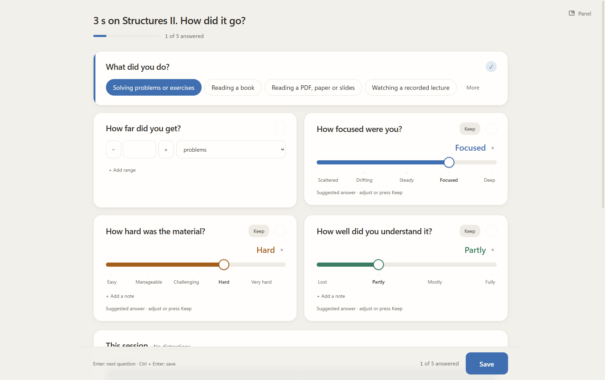

# Learnalyt

**Study with focus. Discover what works for you.**

[Windows beta](https://github.com/abd1442/Learnalyt/releases) · [User guide](USER_GUIDE.md) · [Help](SUPPORT.md)

*Windows x64 · Private draft · Unsigned beta*

Choose a subject. Set your aim. Build a study habit you can see.

## Choose your pace

| Flow | Fixed | Adaptive |
| --- | --- | --- |
|  |  |  |
| Count up. Keep going while you are focused. | Choose a duration and count down. | Get a subject-specific target from recent good sessions. |

Adaptive uses your default until enough qualifying sessions exist. Every mode lets you decide when to finish.

## A complete study session

**Prepare → Focus → Recall → Log → Rest**

Clear distractions, set an aim, then start when you are ready.

### Recall what you learned

Write or draw from memory.

### Record how it went

Choose the questions you want to track.

### Take a break

Rest, then continue or finish your sitting.

## Keep your controls close

| Before you start | While you work |
| --- | --- |
|  |  |

Mark distractions, switch subjects and park thoughts without leaving your work.

## Turn records into useful patterns

| Your question | What to explore |
| --- | --- |
| When do I report better focus? | Compare start times before planning your harder work. |
| Which study conditions suit me? | Compare locations, sound, sleep and other logged conditions. |
| What interrupts my sessions? | Review distraction reasons, lost time and uninterrupted stretches. |
| Am I building a routine? | Follow weekly time, subject progress and the yearly heatmap. |
| What should I try next? | Pick one change, save an experiment and compare later sessions. |

### Conditions and outcomes

### Time patterns

*Patterns reflect your recorded ratings, not proof of cause.*

## Return to what you learned

Reopen a session's timeline, recall and saved notes in History. Find unfinished work or something worth reviewing.

## Save notes to Obsidian

Send text and drawings to a chosen Markdown note and heading. A local copy stays in Learnalyt.

## Make it yours

- Organize subjects, resources and progress in **Library**.
- Set optional daily or personal study reminders.
- Choose light/dark themes, colours, fonts and interface sizes.
- Back up and restore your local study records.
- Export reports as PNG, Markdown or PDF.

*All screenshots are real app captures with fictional demo data. The Obsidian example uses an isolated Demo Vault.*

[Install and get started](USER_GUIDE.md#start-studying) · [Beta details](RELEASE_NOTES.md) · [Privacy](PRIVACY.md)
