

  <picture>
    <source media="(prefers-color-scheme: dark)" srcset="assets/focusrecall-lockup-dark.svg">
    
  </picture>

<h3 align="center">A study timer for Windows, with recall notes and a private record of your study.</h3>

  Time a subject in a small floating panel, write down what you remember, and come back to it later. 
  Your records stay on your computer.

  <b>Windows x64</b> &nbsp;·&nbsp; <b>0.1.0-beta.29</b> &nbsp;·&nbsp; <b>7 languages</b> &nbsp;·&nbsp; <b>GPL-3.0-only</b>

  <a href="#two-ways-to-study">Modes</a> &nbsp;·&nbsp;
  <a href="#a-full-mode-session">Study cycle</a> &nbsp;·&nbsp;
  <a href="#the-floating-timer">Timer</a> &nbsp;·&nbsp;
  <a href="#history-and-notes">History</a> &nbsp;·&nbsp;
  <a href="#stats">Stats</a> &nbsp;·&nbsp;
  <a href="#learn">Learn</a> &nbsp;·&nbsp;
  <a href="#themes-text-and-language">Themes</a> &nbsp;·&nbsp;
  <a href="#privacy">Privacy</a> &nbsp;·&nbsp;
  <a href="#backups-and-updates">Backups</a> &nbsp;·&nbsp;
  <a href="#install">Install</a>

 

  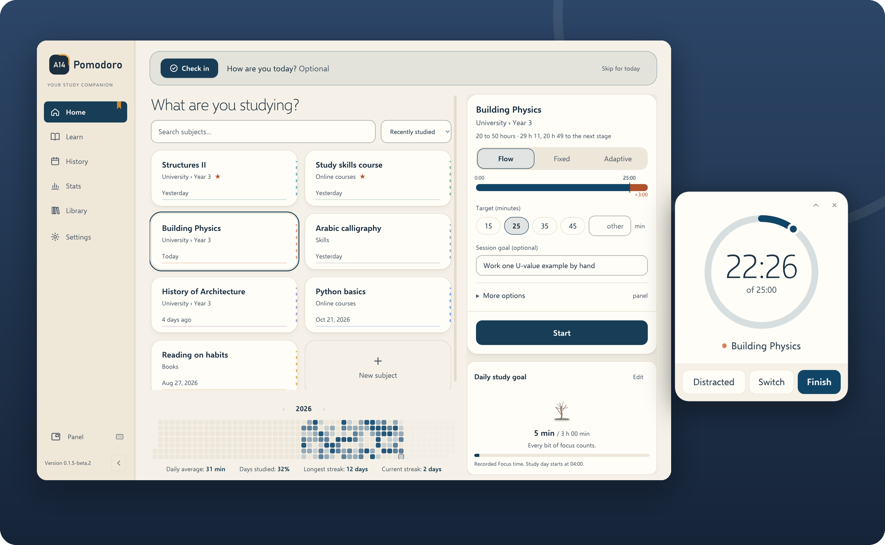

 

You choose a subject and start a timer. A small floating panel keeps time while you work in your book, browser or editor. When you finish, FocusRecall can ask you to write down what you remember before you look back at your material, then keeps the session, your notes and anything you marked to revisit.

Use as much or as little of it as you like. Notes, ratings, rest timers and automatic tracking are all optional, and you never need an account.

<table>
  <tr><td><b>Two modes</b></td><td>Quick Mode is a timer and nothing else. Full Mode adds recall, a short log and timed rest.</td></tr>
  <tr><td><b>Floating timer</b></td><td>Digital or circular. Mark distractions, switch subjects, finish.</td></tr>
  <tr><td><b>Recall notes</b></td><td>Typed or drawn, searchable in History, with follow-ups marked for review.</td></tr>
  <tr><td><b>Study records</b></td><td>A calendar of study days, History, and Stats that separate time from learning.</td></tr>
  <tr><td><b>Learn</b></td><td>One short idea about studying each day, with the research behind it and its limits.</td></tr>
  <tr><td><b>Local and private</b></td><td>No telemetry, ads, cloud sync or account. Verified backups in one click.</td></tr>
</table>

 

## Two ways to study

  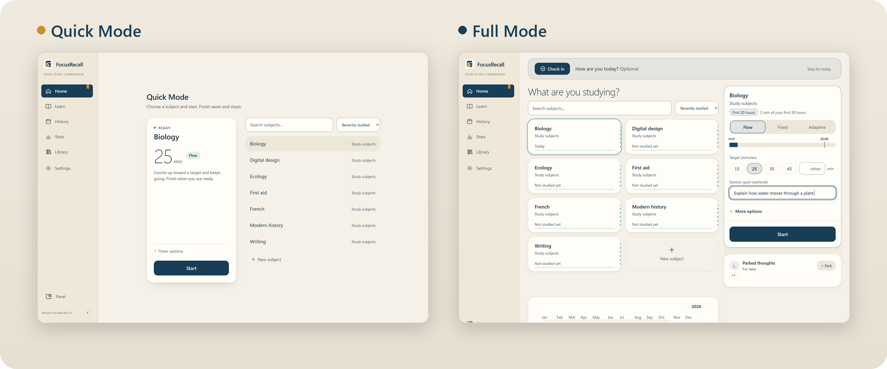

|  | Quick Mode | Full Mode |
| :-- | :-- | :-- |
| **Start** | Pick a subject, press Start | Pick a subject, set an optional goal, press Start |
| **While studying** | Distracted · Switch · Finish | Distracted · Switch · Finish |
| **After Focus** | Saved. Take a break if you want one | Optional recall notes, session log and timed rest |
| **Extras on Home** | None, just the launcher | Parked thoughts, study calendar, stage line |

You choose a mode during setup and can change it later in **Settings** between sessions. Both modes share the same subjects, History, Stats, Learn and Library, and switching never rewrites your records.

### Quick Mode in five steps

1. On Home, select or create a subject. **Timer options** changes the target and timer type.
2. Press **Start**. The floating timer opens.
3. Pulled away? Press **Distracted** to stop the focus clock and **Resume** to continue.
4. To change subjects, open the subject name on the panel, pick another and confirm **Switch now**. Each subject keeps its own time.
5. Press **Finish** to save and stop. Nothing else is required.

While paused, **Break** saves the session and offers a break timer. When the break ends, studying does not restart until you press **Resume**.

 

## A Full Mode session

Full Mode walks through one study cycle. Every step after Start can be skipped.

  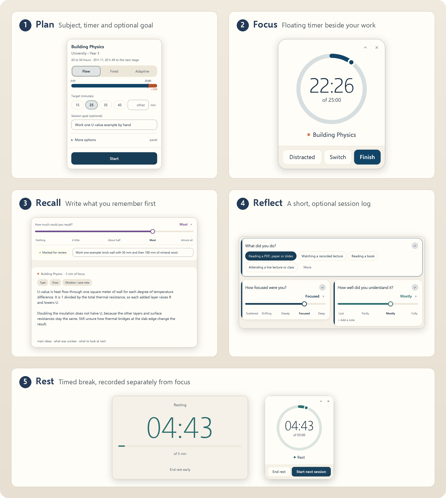

**1 · Plan.** Select a subject on Home and choose a timer:

- **Flow** counts up past a target marker, for when you want to keep going while it's working.
- **Fixed** counts down from the time you have.
- **Adaptive** suggests a target from your recent sessions on that subject. You can override it.

A short, specific goal helps: *"Explain how water moves through a plant"* is easier to check afterwards than *"Study biology"*. It stays attached to the session.

**2 · Focus.** Work wherever you normally do. The floating timer stays on top so you can see time and mark interruptions without switching windows. Details are in [The floating timer](#the-floating-timer).

**3 · Recall.** After Focus, try to explain what you remember *before* checking your notes. Optionally start a short review timer, then **Type notes** or **Draw notes**, or use paper. Write the main idea and one thing you're unsure of. **Review later** turns that uncertainty into a reminder you can find in History. Rating how much you could recall is optional.

**4 · Log and rest.** *How did it go?* asks a few optional questions; choose which ones in **Settings → Log questions**. Then pick a rest length and press **Start rest**. Rest is recorded separately and never counts as focus time. When it ends, start another session or choose **Finish studying**.

<b>More about the cycle</b>: preparation, Today Check, keyboard shortcuts and short sessions

 

- **Get ready.** If preparation is turned on, a short panel appears before the timer starts.
- **Today Check.** The optional check-in at the top of Home can be answered or skipped. **Skip for today** hides it until local midnight, even after a restart. Settings can hide it permanently without erasing earlier check-ins.
- **Ctrl+Enter** continues from review or the log when the next action is available. Check the visible button first.
- **Very short sessions.** If you finish very quickly, FocusRecall asks whether to keep the session. Choose **Keep it** if it belongs in your history.
- **Locking or sleeping Windows** interrupts timing. The gap is not counted as focus; follow the prompt when you return.

 

## The floating timer

  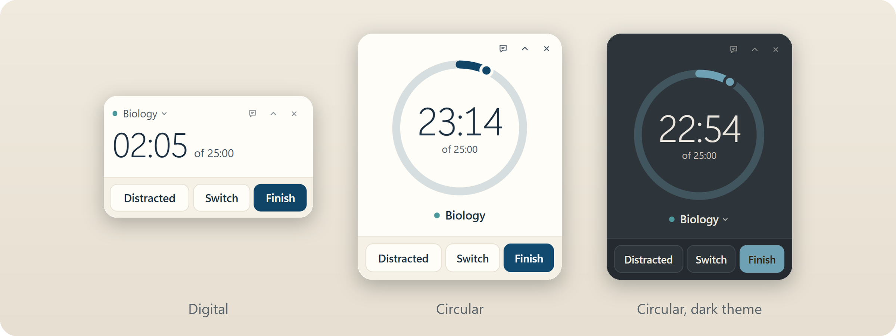

| Control | What it does |
| :-- | :-- |
| **Distracted** | Stops the focus clock while you're away. **Resume** (Quick) or **Back** (Full) continues the same session. |
| **Switch** | Moves to another subject without ending the session. Time is kept per subject. |
| **Finish** | Ends Focus. Quick Mode saves; Full Mode moves on to recall. |

- Choose **Digital** or **Circular** in **Settings → Appearance → Floating panel**. Circular shows time left to the target, then overtime. Size and opacity are adjustable.
- Drag the panel anywhere. If you close it, **Panel** in the sidebar or **Show timer** brings it back.
- Every panel action is also available from the main window, by keyboard.

 

## Home tools

These live on the Full Mode Home screen.

**Parked thoughts.** Press **+ Park** (or the shortcut shown on the card, such as F7) to note a question that can wait, like *"Check how humidity changes water loss."* Repeated captures are grouped with a count. Tick them off later or use **Manage thoughts**.

**Saved for later.** If you put off an unfinished review, log or rest, it appears here with a **Resume** button. Time while the app was closed is not counted as rest.

**Study calendar.** Each square is a day, shaded by recorded focus time. Select a day to open it in History. With the keyboard, arrow keys move between days and Enter opens one.

**Stage line.** The line under a subject, such as *First 20 hours*, shows time invested in it, including earlier hours you entered yourself. It measures time, not skill. Labels and boundaries can be changed in Settings.

Subjects can be grouped into categories and sorted by **Manual**, **Alphabetical**, **Recently studied** or **Most studied**.

 

## History and notes

  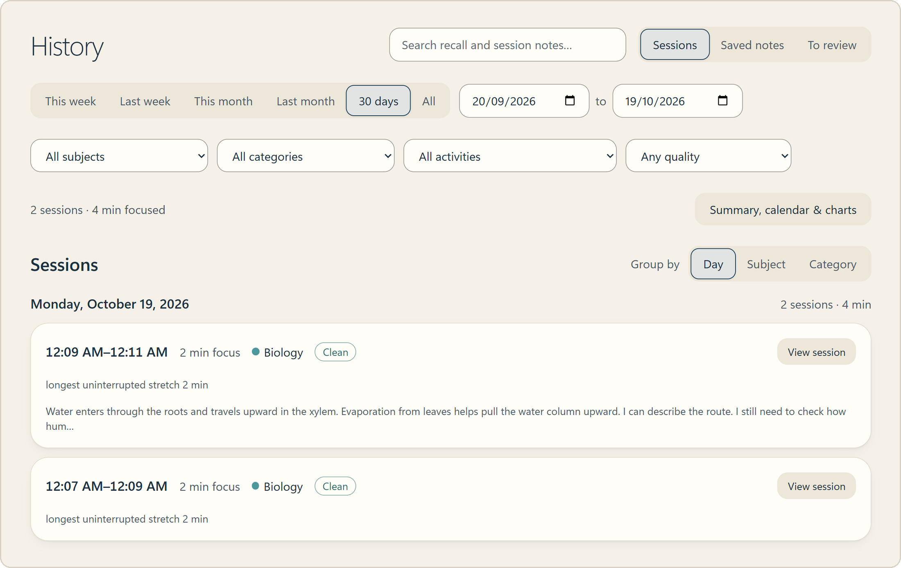

Filter by dates, subject, category or activity, and open any session with **View session**. Search covers recall and session notes. **Saved notes** collects everything you wrote; **To review** lists the follow-ups you marked. **Library** groups material by subject.

To keep a note in Obsidian, choose **Obsidian / save note** and pick a destination. Your vault needs its own backup, since FocusRecall backups don't include it.

 

## Stats

  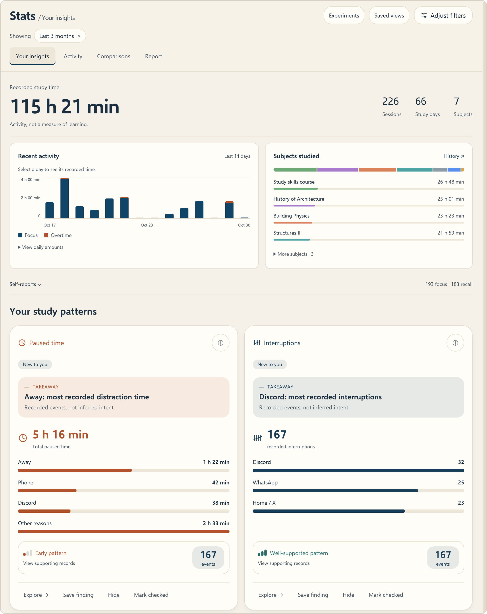

Stats starts with what was recorded: time, sessions, subjects and recent activity. **Adjust filters** shows exactly which days and subjects are included, and **Saved views** keeps a filter setup for later.

When you have enough comparable sessions, Stats can compare conditions, and it says plainly when the evidence isn't there yet. Keep three things apart when reading it:

| What Stats shows | What it can't prove on its own |
| :-- | :-- |
| Time spent | That you learned |
| How a session felt | That you'll remember it |
| Patterns between sessions | What caused them |

To judge learning, test yourself on the material later. A timer and a self-rating can't replace that.

 

## Learn

  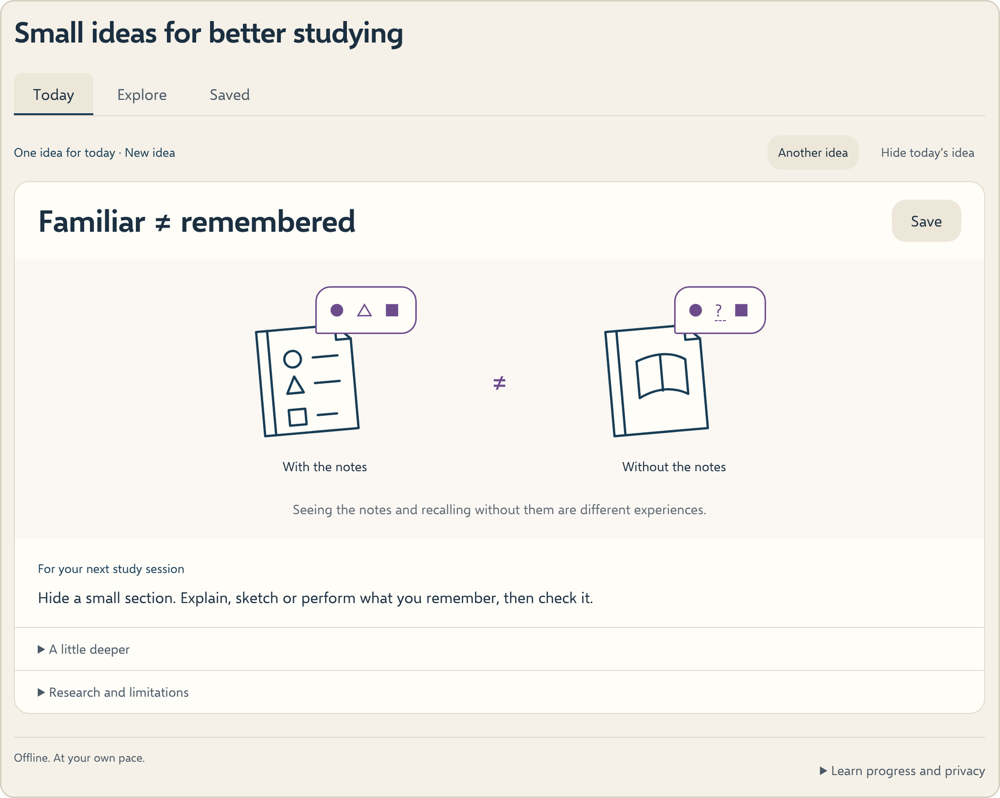

**Today** shows one idea about studying, with a short explanation, a suggestion to try in your next session and a **Research and limitations** section. **Explore** lets you browse all 27 ideas and **Saved** keeps the ones you bookmark. **Another idea** offers something new, then cycles back through ideas you've already seen.

 

## Themes, text and language

  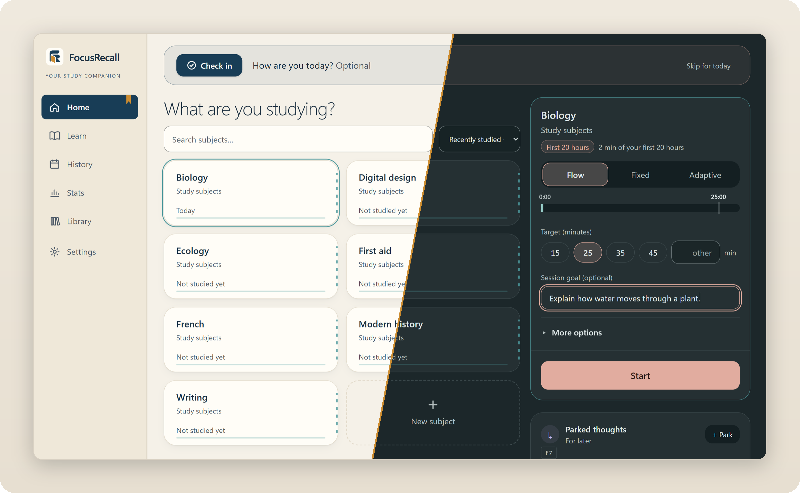

Open **Settings → Appearance** and choose **Light**, **Dark** or **Follow Windows**. FocusRecall remembers one light and one dark theme, so following Windows switches between your two choices. There are **26 themes**: 11 light and 15 dark. A theme applies immediately, with a brief **Undo**.

- **Text & size** adjusts interface and writing text separately. **High contrast** works with any theme.
- **Floating panel** sets the timer style, size and opacity.
- **Languages:** English, العربية, Español, Français, 简体中文, Português (Brasil) and Deutsch. Arabic uses a right-to-left layout.

<b>See the theme gallery</b>

 

  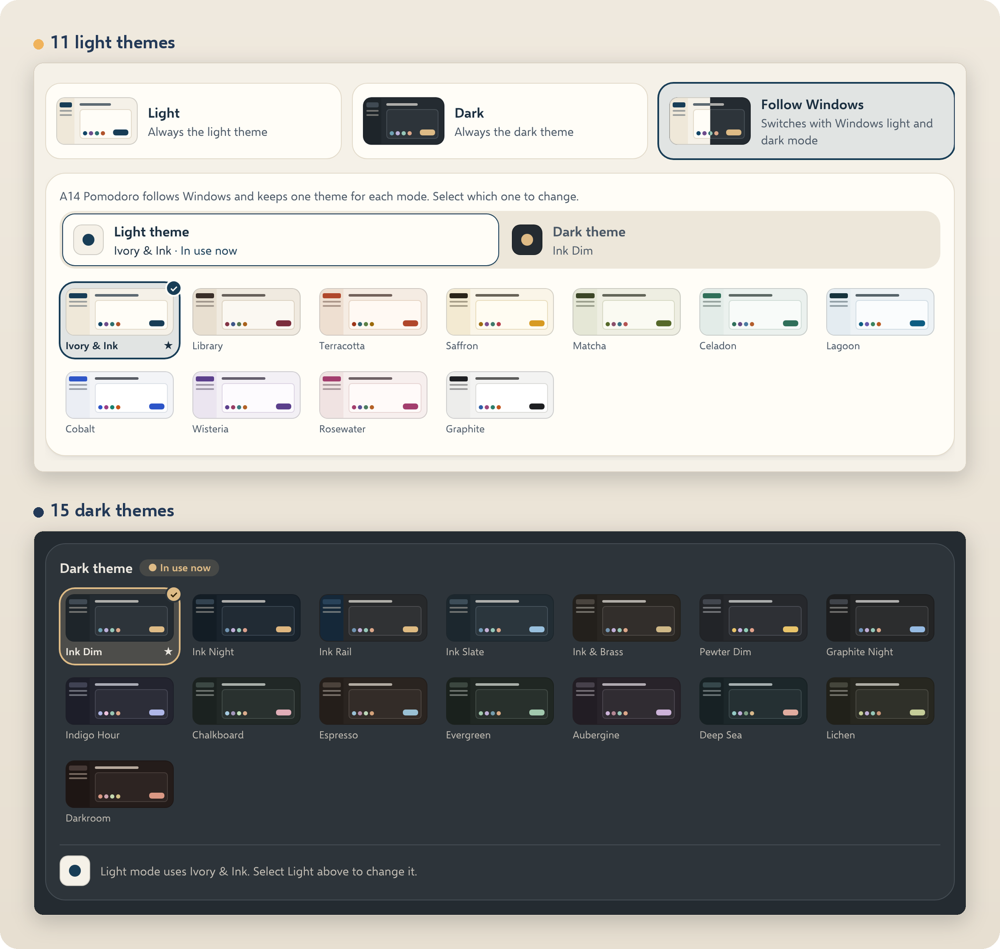

 

## Privacy

  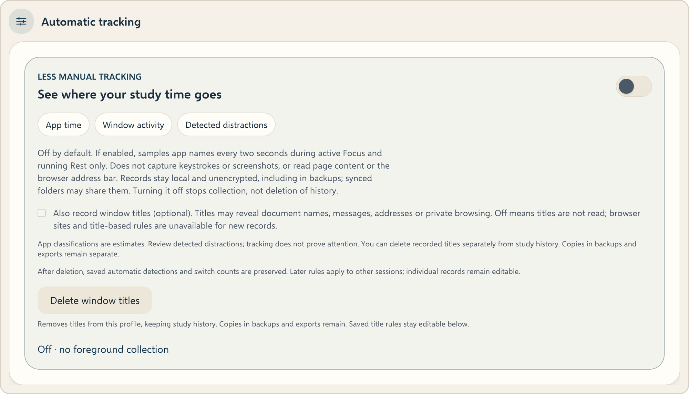

- Study records stay on your computer. There is **no telemetry, advertising, cloud sync or automatic update check**, and no account.
- **Automatic tracking is off** by default. If you turn it on, it samples app names during Focus and Rest only. It never captures keystrokes, screenshots or page content.
- **Window titles** are a separate opt-in, because titles can contain private text. **Delete window titles** removes them from your profile and keeps your study history; copies in older backups or exports are not touched.
- Databases and backups are **not encrypted**. Protect your Windows account and wherever you keep backups.

[Full privacy information](PRIVACY.md)

 

## Backups and updates

  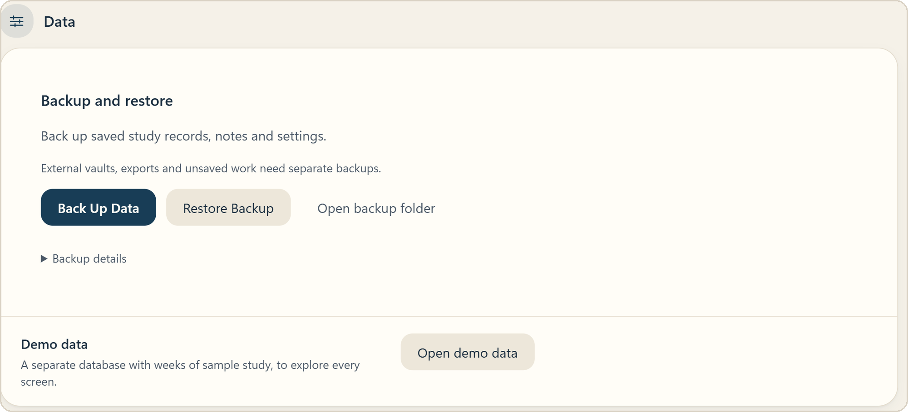

**Settings → General → Data → Back Up Data** saves your study records, notes and settings, and checks the backup before reporting success.

Before installing an update:

1. Finish any session in progress.
2. Use **Back Up Data** and keep a copy somewhere else. Back up an Obsidian vault separately.
3. Quit FocusRecall from its tray icon, then run the new installer.
4. Reopen it and check your subjects, a recent session and your notes.

Uninstalling keeps your profile. **Restore Backup** replaces the current database after checking the backup and asking you to confirm, and keeps a safety copy of what it replaced. Never delete profile folders or database files to fix a problem; see [troubleshooting](docs/USER_GUIDE.md#if-something-goes-wrong).

 

## Install

FocusRecall runs on 64-bit Windows. Version 0.1.0-beta.29 is not publicly available yet ([availability](docs/RELEASE_STATUS.md)). If you've been invited to test, use only the installer and checksum you were given. The test build is unsigned, so keep Windows security turned on and report any warning you see.

On first launch, pick Quick or Full Mode and your language. To look around before adding your own subjects, choose **Open demo data** in **Settings → General → Data**. It opens a separate database of made-up study and leaves your own records untouched.

 

## Help

| If… | Then… |
| :-- | :-- |
| Your study data won't open | Stop. Keep the original files and backups, note the exact message and [ask for help](SUPPORT.md). Don't reset anything. |
| Windows or antivirus shows a warning | Keep protection on and note the warning and installer version. |
| The app keeps running after closing | Quit from the tray icon, especially before updating. |
| Stats shows no comparison | Check the filters. Early records may not be enough yet. |
| Text or the timer is too small | **Settings → Appearance → Text & size** or **Floating panel**. |

The [user guide](docs/USER_GUIDE.md) has every screen in detail and more troubleshooting. For a bug report, include the app version, Windows build, the steps and the exact error, and never attach your database, backups or vault. [Help and bug reports](SUPPORT.md) · [Security reports](SECURITY.md)

 

## Source and license

FocusRecall's original code is licensed **GPL-3.0-only**. [License](LICENSE) · [Third-party notices](THIRD-PARTY-NOTICES.txt) · [Source package information](SOURCE_NOTICE.md) · [Development repository](https://github.com/abd1442/FocusRecall-Dev)

Use the source package that matches your installer; the development repository may be ahead of an installed build. Screenshots show real application screens with made-up subjects and notes.

---

 

  <a href="https://ko-fi.com/abd442">
    <picture>
      <source media="(max-width: 600px) and (prefers-color-scheme: dark)" srcset="assets/support-kofi-banner-mobile-dark.png">
      <source media="(max-width: 600px)" srcset="assets/support-kofi-banner-mobile.png">
      <source media="(prefers-color-scheme: dark)" srcset="assets/support-kofi-banner-dark.png">
      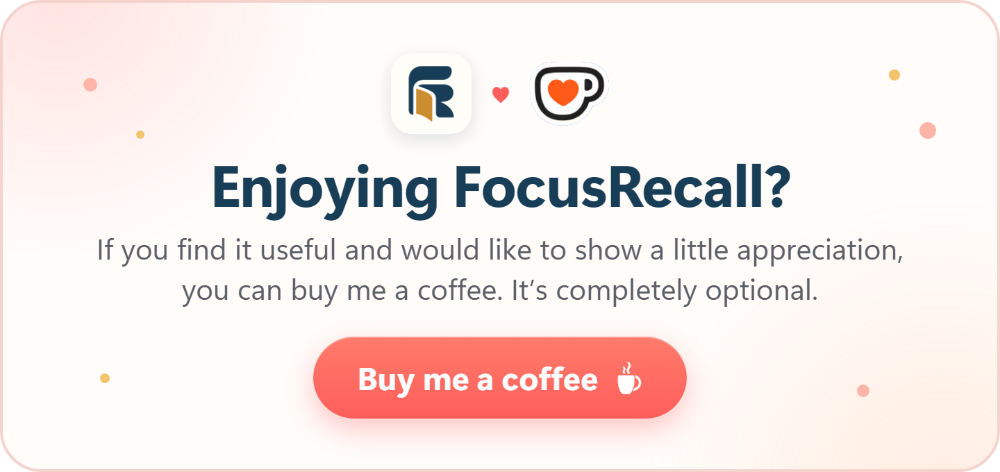
    </picture>
  </a>

