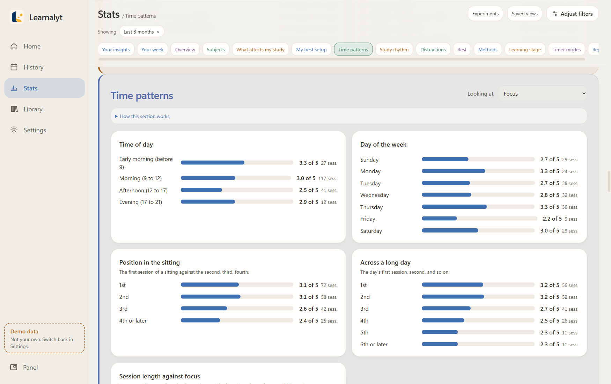
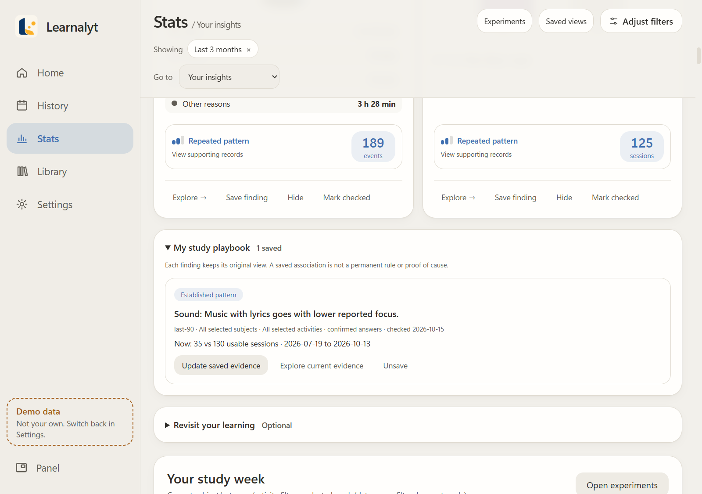
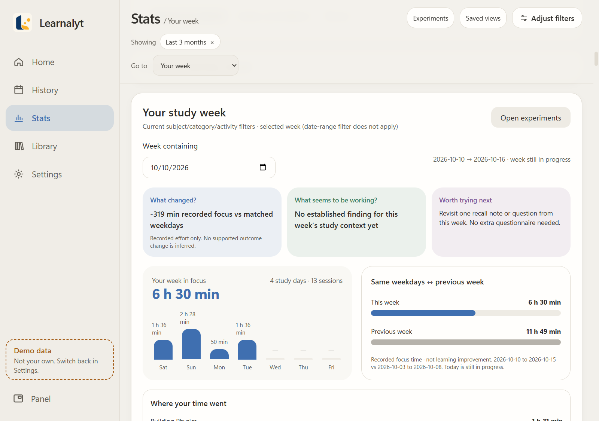
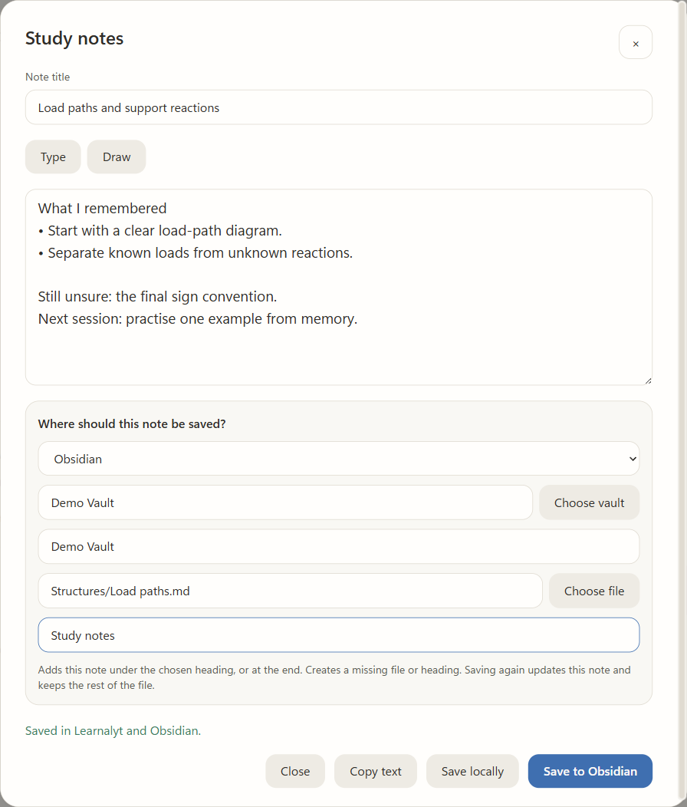
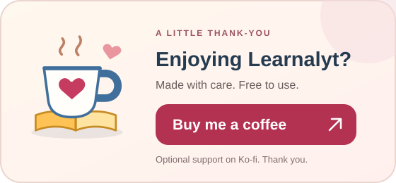

# Learnalyt

**Study with focus. Understand your habits. Keep your data.**

A free Windows app for study timers, recall notes and personal insights.

[Windows downloads](https://github.com/abd1442/Learnalyt/releases) · [User guide](USER_GUIDE.md) · [Suggest an improvement](https://github.com/abd1442/Learnalyt/issues)

## Why I built it

I made Learnalyt for myself. I couldn't find an app that combined the study timer, detailed session records and personal insights I wanted, while keeping that information on my own computer.

I wanted to understand my studying without handing my study history and private notes to a service. Learnalyt grew from that need.

## Study at your own pace

| Flow | Fixed | Adaptive |
| --- | --- | --- |
|  |  |  |
| Count up and keep going. | Count down from your chosen duration. | Use a target informed by your confirmed study records. |

## Keep the timer beside your work

| Get ready | Keep studying |
| --- | --- |
|  |  |

Mark a distraction, switch subjects or park a thought without leaving your work.

## Remember more than the time spent

**Study → Review → Log → Rest → Next session**

Review with an optional timer. Write, draw or connect ideas in your own way.

Record a few answers, or open the details you care about. Previous suggestions stay unconfirmed until you accept them.

Choose your rest duration and optional playlist, then start the break. Continue with the same subject or choose another.

## Find patterns worth testing

Compare your **reported focus and recall** across study conditions, times and activities. See the supporting records and how much evidence a finding has.

**For example:** compare your library and home sessions before trying a different study place. Patterns describe your records, not proof of cause.

## Build your own study playbook

Save useful findings. Recheck their evidence as your records grow. See when support weakens or a finding changes direction.

## Make the next week useful

See **what changed**, **what seems to be working**, and **what is worth trying next**. Optional experiments help you try one practical change using records you already collect.

## Return to earlier learning

Search past sessions, revisit recall and notes, or return to an idea you marked for review.

## Keep a copy in Obsidian

Send writing and drawings to a note you choose. Nothing is sent automatically.

## Your records stay yours

- Local study records, notes and backups. No account or required subscription.
- Optional tracking, reminders and exports stay under your control.
- Light and dark themes, adjustable text and interface sizes.
- Local backup and restore, plus PNG, Markdown and PDF reports.

[Privacy details](PRIVACY.md) · [Installation and backups](USER_GUIDE.md#install-on-windows) · [Build availability](RELEASE_NOTES.md)

*Real app screenshots with fictional records. Obsidian uses an isolated demonstration vault.*

Have an idea that would make studying easier? [Suggest it here](https://github.com/abd1442/Learnalyt/issues). Please leave private notes and study records out of reports.

---

  

