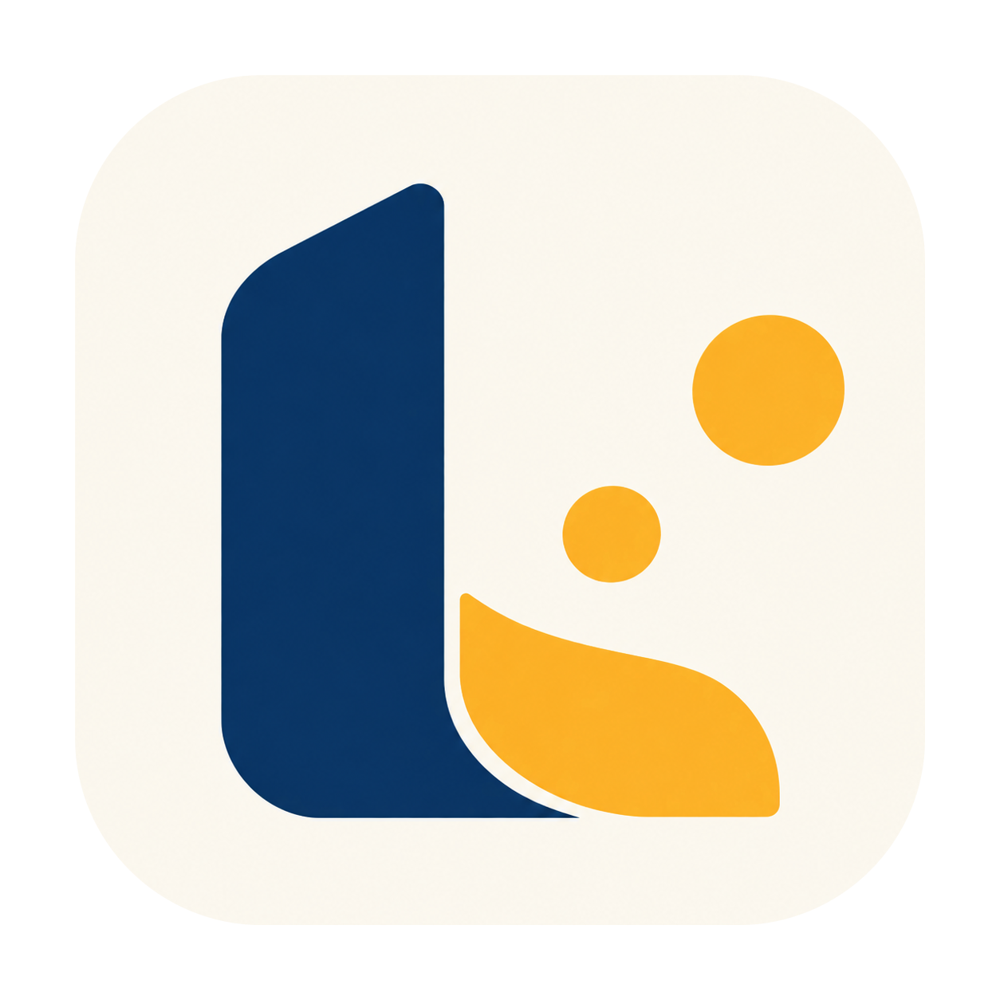

# Learnalyt

**Make time to study. Understand your patterns.**

Learnalyt is a Windows app for focused study, recall and personal reflection. Plan a session, put distractions aside, write what you remember and discover which conditions accompany your better study days.

*Real application screenshots use fictional demo records.*

## Get Learnalyt for Windows

**Private distribution preview:** the installer is prepared as an unpublished draft prerelease for owner review. General downloads are not available yet. Download links become available after a release is approved and published. While this repository is private, access requires repository permission.

[Windows downloads](https://github.com/abd1442/Learnalyt-Releases/releases) · [Illustrated user guide](USER_GUIDE.md) · [What's new](RELEASE_NOTES.md) · [Help](SUPPORT.md)

1. Open **Windows downloads** and choose the latest approved Windows x64 beta.
2. Download **Learnalyt-0.1.0-beta.1-setup.exe** from the release's **Assets** section. The source ZIP is not the installer.
3. Close Learnalyt, run the setup EXE and follow Windows prompts. Open Learnalyt from its shortcut.

You do not need Node.js, npm or a terminal. The candidate installer is unsigned, so Windows may show an unknown-publisher warning. Verify its checksum and origin; do not disable Windows protection. Clean-install and installed-upgrade testing are still pending. See [beta status](RELEASE_NOTES.md).

Before an update, use **Settings > Back Up Data** and quit from the tray menu. Keep your existing data folder. Backups of external Obsidian files and exported reports are separate.

## A study routine you can make your own

- **Choose your pace:** Flow, Fixed or Adaptive planning, a floating timer and preparation with two default reminders plus evidence-backed personal checks.
- **Stay with the task:** mark distractions, switch subjects within a session and park thoughts for later.
- **Recall before reviewing:** write or draw what you remember, answer your own logging questions and take a rest.
- **Keep useful records:** organize subjects, resources and notes; review or correct History; resume unfinished work.
- **Explore patterns:** personal comparisons, detailed Stats, Your week, saved views, experiments and PNG, Markdown or PDF reports.
- **Remember to begin:** optional daily Windows reminders and personal focus-window nudges, with quiet hours and pause controls.
- **Make it comfortable:** light/dark themes, high contrast, flexible sizes and appearance presets.

## See your own study story

Learnalyt describes associations in your recorded conditions. Ratings are self-reports, not objective mastery scores or proof that one method causes better learning. Start with a small change and compare your own experience.

## Your records stay local

No account or backend is required. Automatic foreground app/window tracking is off unless you enable it. Notes stay local unless you explicitly send them to a selected Obsidian destination. Local storage is not application-level encryption. Read [Privacy](PRIVACY.md).

## Your first session

1. Create a subject in Library or use New subject on Home.
2. Choose the subject, mode and target. Add a goal if useful.
3. Start, then press Ready to start if preparation is enabled.
4. Finish, recall, log and rest or end the sitting.

The [illustrated guide](USER_GUIDE.md) covers the complete workflow, notes, History, Stats, appearance, backup and recovery. For help, use [Support](SUPPORT.md).
