

  <picture>
    <source media="(prefers-color-scheme: dark)" srcset="assets/focusrecall-lockup-dark.svg">
    
  </picture>

A Windows study timer with recall notes, session history and study records that stay on your computer.

  
  
  
  

  <a href="#two-ways-to-study">Quick and Full Mode</a> ·
  <a href="#subjects-and-timer-modes">Subjects</a> ·
  <a href="#history-stats-and-learn">History, Stats, Learn</a> ·
  <a href="#appearance-and-languages">Appearance</a> ·
  <a href="#privacy">Privacy</a> ·
  <a href="#backups-and-updates">Backups</a> ·
  <a href="docs/USER_GUIDE.md">User guide</a>

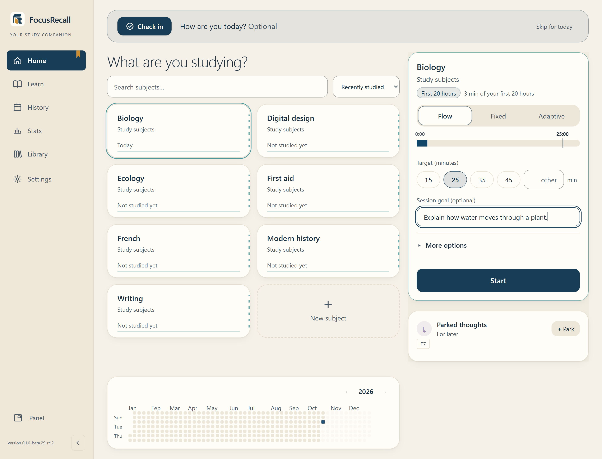

> [!NOTE]
> FocusRecall is in controlled testing. There is no public download yet. [Availability](docs/RELEASE_STATUS.md)

FocusRecall times your study sessions by subject. When a session ends you can write or draw what you remember, rate how it went, and take a timed rest. Sessions and the notes you choose to keep appear in a local history that you can search, review and summarise in Stats. Use as much or as little of this as you like: the timer works on its own.

All screenshots on this page come from the actual application running with fictional study data.

## Two ways to study

Pick one during first-time setup. You can switch between sessions in **Settings**; both modes share the same subjects, history and preferences, and switching does not change past records.

| | Quick Mode | Full Mode |
| --- | --- | --- |
| Start | Choose a subject, select **Start** | Choose a subject and an optional goal, select **Start** |
| During the session | Distracted, Switch, Finish; optional break while paused | Floating timer: Distracted, Switch, Finish |
| After the session | Nothing required | Review & connect → session log → rest |
| Good for | Getting straight to work | Recall practice and detailed records |

### Quick Mode

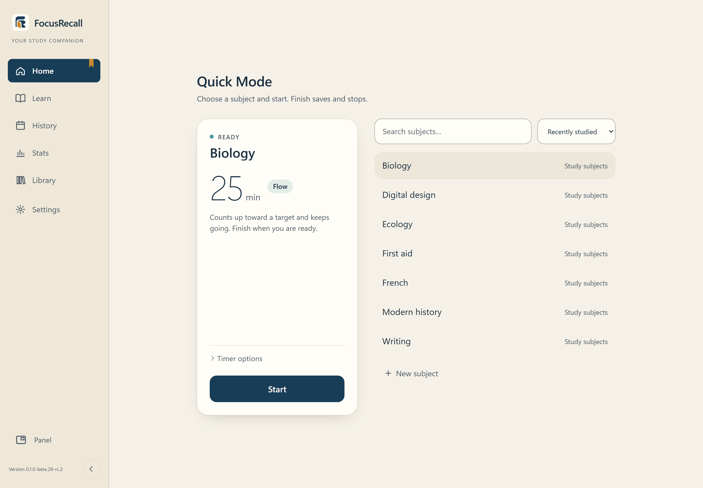

Select a subject, adjust **Timer options** if you want, and select **Start**. The floating timer opens over your other windows.

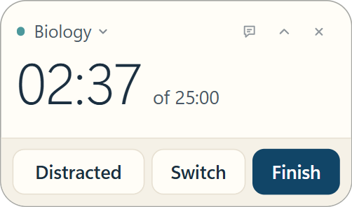

- **Distracted** stops the focus clock; **Resume** continues the same session.
- **Switch**, or the subject name, lets you change subjects while preserving each subject’s recorded time.
- **Break** (while paused) saves the session and starts an optional break timer. Studying resumes only when you choose **Resume**.
- **Finish** saves and stops. Select **Start** yourself when you want another session.

Quick Mode never asks for preparation, recall notes, ratings or a rest. The same controls are also available in the main window, where they can be used from the keyboard.

### Full Mode

A Full session moves through **Focus → Review & connect → Log → Rest**. Every step after Focus is optional and can be skipped.

**1. Focus.** Study in your book, browser or editor while the floating panel keeps time.

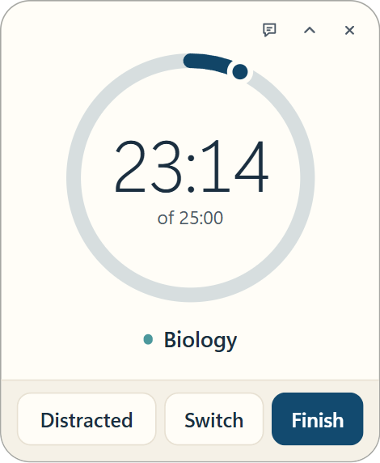

- **Distracted** marks time away from study; **Back** resumes.
- **Switch** changes subject inside the session.
- **Finish** moves on to review.

**2. Review & connect.** Before checking your materials, write or draw what you remember. Mark anything you want to revisit with **Review later**. A short review timer is available if you want one.

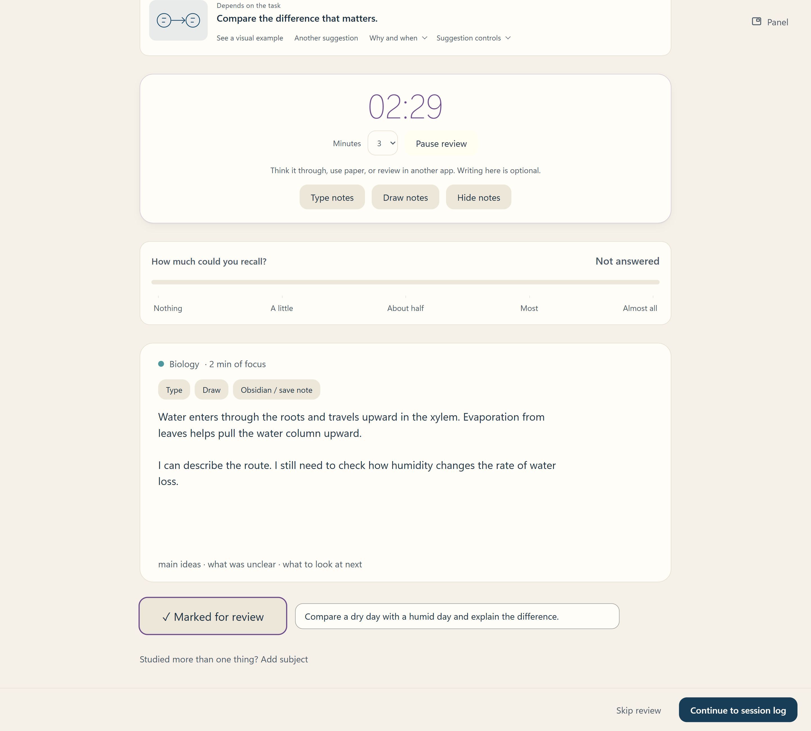

**3. Log.** Answer only the questions you find useful, such as how focused you felt or how much you could recall. **Settings → Log questions** controls which ones appear.

**4. Rest.** Pick a duration and start the countdown. Rest is recorded separately and never counts as study time. **End rest early** is always available.

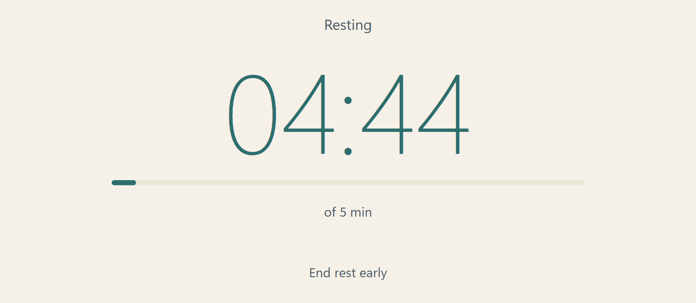

### Floating timer: Digital or Circular

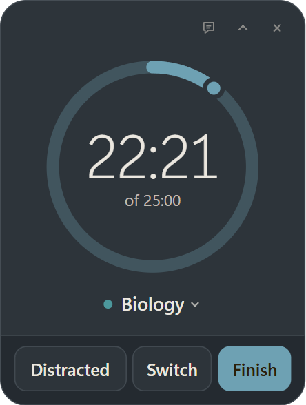

**Digital** (shown under Quick Mode above) displays elapsed time or a countdown, depending on the timer mode. **Circular** shows the time left to the target with a progress ring, then overtime. Choose one in **Settings → Appearance → Floating panel**, where you can also set the panel's size and opacity. Both use the same clock.

Locking Windows or putting the computer to sleep stops observed timing. That gap is not counted as study time, and a prompt asks what happened when you return.

## Subjects and timer modes

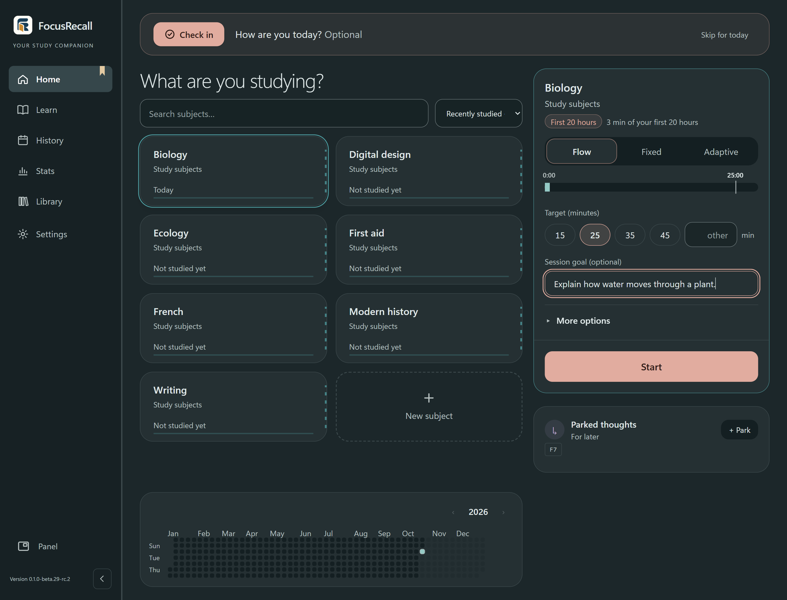

Create a subject with **New subject** and, if you like, group subjects into categories such as *University › Year 3*. Search and sort sit in one row: manual order, alphabetical, recently studied or most studied.

Each subject has a timer mode and a target:

| Mode | What the timer does |
| --- | --- |
| **Flow** | Counts up, with a marker at the target. You can keep going past it. |
| **Fixed** | Counts down from the target, then shows overtime. |
| **Adaptive** | Suggests a planning target from eligible past focus ratings, using your default until enough history exists. You can override it; this does not measure learning. |

The line under a subject (for example *20 to 50 hours*) shows total recorded time against study-time milestones you can customise. It describes time spent, not mastery.

Home also has **Parked thoughts** for writing down something that can wait (default shortcut **F7**), **Saved for later** for unfinished review or log steps, an optional daily **Today Check**, and a year calendar shaded by study time.

## History, Stats and Learn

### History

Find past sessions by date, subject or activity, search your notes, and open any session to see its timeline and what you wrote. **To review** collects the points you marked. Notes can be saved to an Obsidian vault when you choose to.

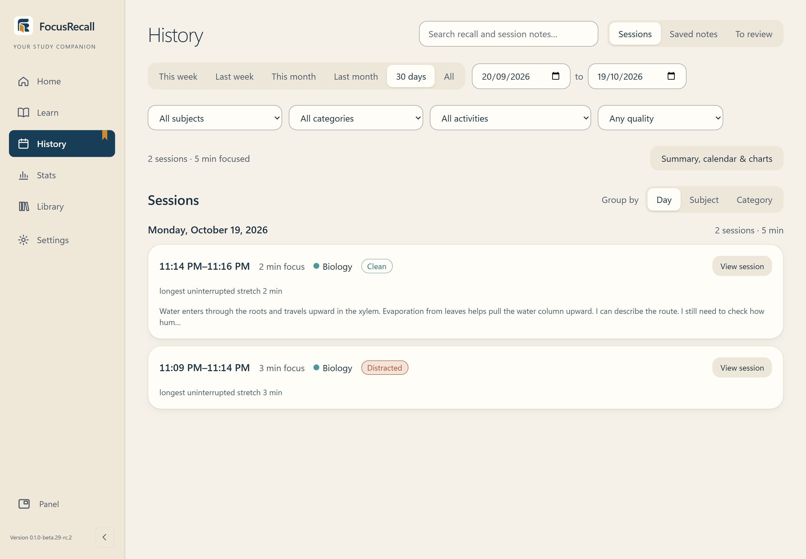

### Stats

Stats starts with recorded study time, sessions and study days, then lets you look at activity, subjects, interruptions and comparisons between conditions. Filters show exactly which records are included, and each comparison explains how much evidence supports it.

| Stats records | It does not show |
| --- | --- |
| Time spent | How much you learned |
| Your own ratings | How much you will remember |
| Differences between conditions | What caused them |

### Learn

Learn explains study techniques with illustrations, a practical suggestion and the research behind each one, including its limits. There are 27 illustrated ideas and 24 strategies to browse, an idea for **Today**, and a **Saved** list. **Another idea** cycles through the content; previously shown ideas are labelled separately from new ones. Learn's general guidance is kept separate from your personal Stats.

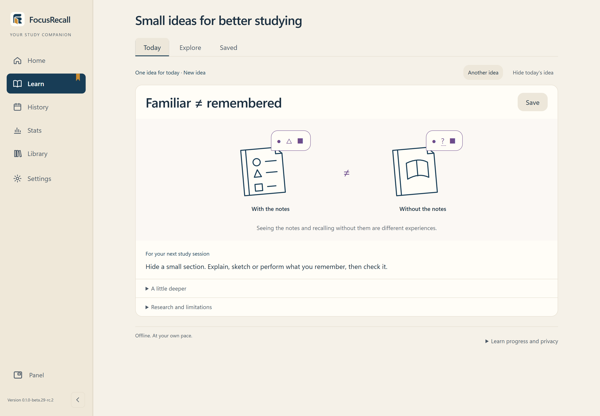

## Appearance and languages

Open **Settings → Appearance**. Choose **Light**, **Dark** or **Follow Windows**, then pick a theme from the gallery below. There are 26 themes: 11 light and 15 dark. FocusRecall saves one light theme and one dark theme, so with Follow Windows it switches between your two choices automatically.

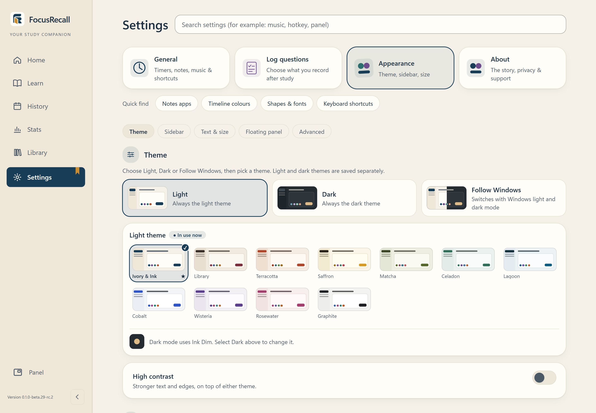

*With **Light** or **Dark** selected, the gallery shows that mode's themes and a choice applies immediately.*

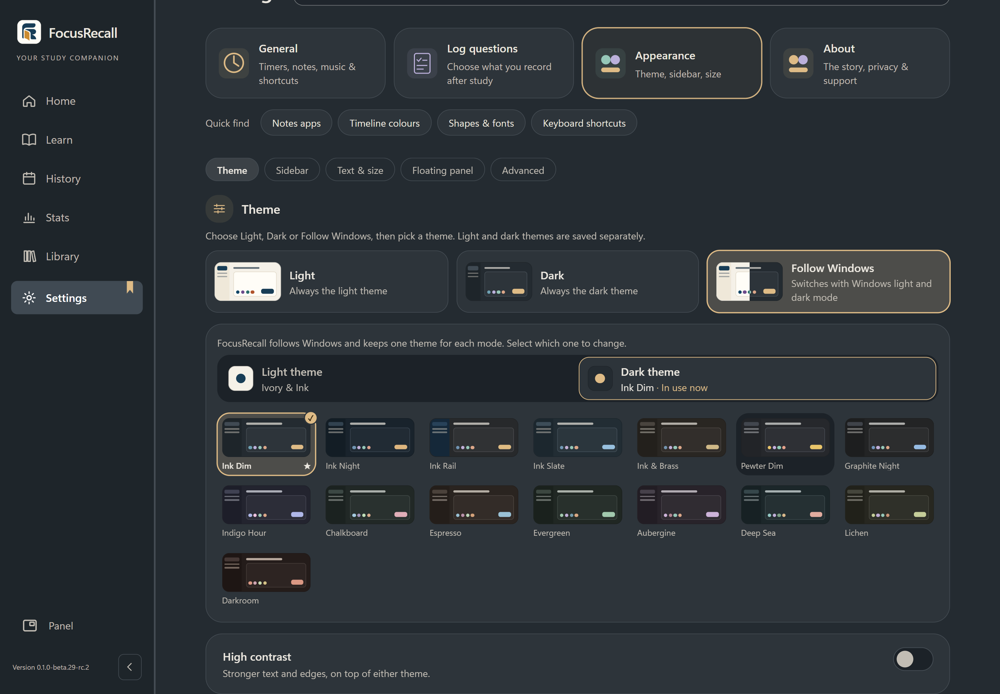

*With **Follow Windows**, the **Light theme** and **Dark theme** tabs choose which of your two saved themes you are changing.*

Appearance also covers high contrast, interface size, sidebar style, corner shape, fonts, stage colours and the floating panel. Saved setups can be exported and imported.

FocusRecall is available in **English, العربية, Español, Français, 简体中文, Português (Brasil) and Deutsch**. Arabic uses a full right-to-left layout, and the interface supports keyboard navigation throughout.

## Privacy

- No account. Study records, notes and settings are stored on your computer.
- No telemetry, advertising, cloud sync or automatic update checks.
- Automatic tracking of which app is in front is **off by default**. If you turn it on, it samples app names only during Focus and Rest. Recording window titles is a separate choice, and stored titles can be deleted without touching your study history.
- Reports and Obsidian exports are explicit actions. Backups include manual copies and automatic local safety snapshots.

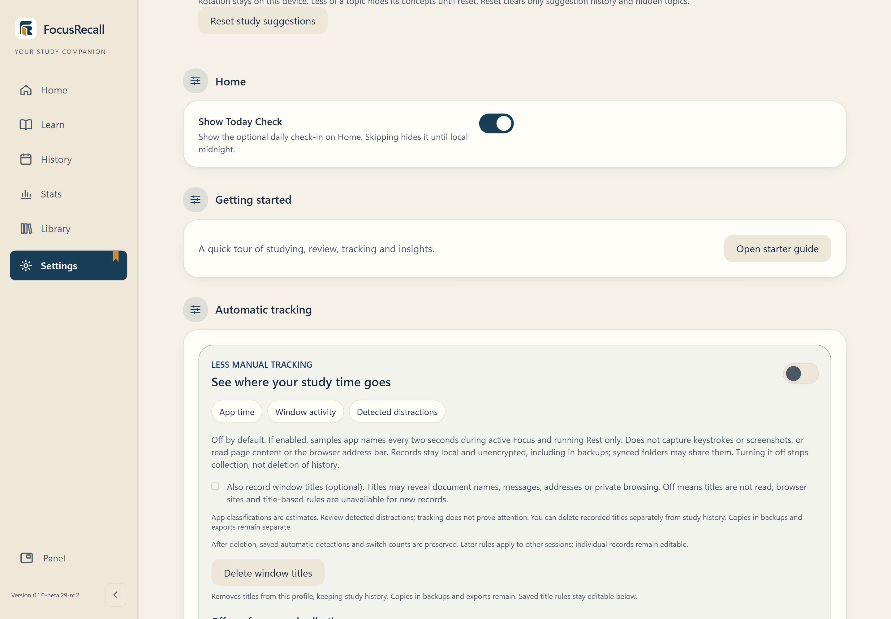

FocusRecall does not encrypt its database or backups, so protect your Windows account and wherever you keep backups. Deleting window titles does not remove copies already in backups or exports. [Full privacy details](PRIVACY.md)

## Backups and updates

**Settings → General → Data** creates a verified backup of your records, notes and settings, restores one, or opens the backup folder.

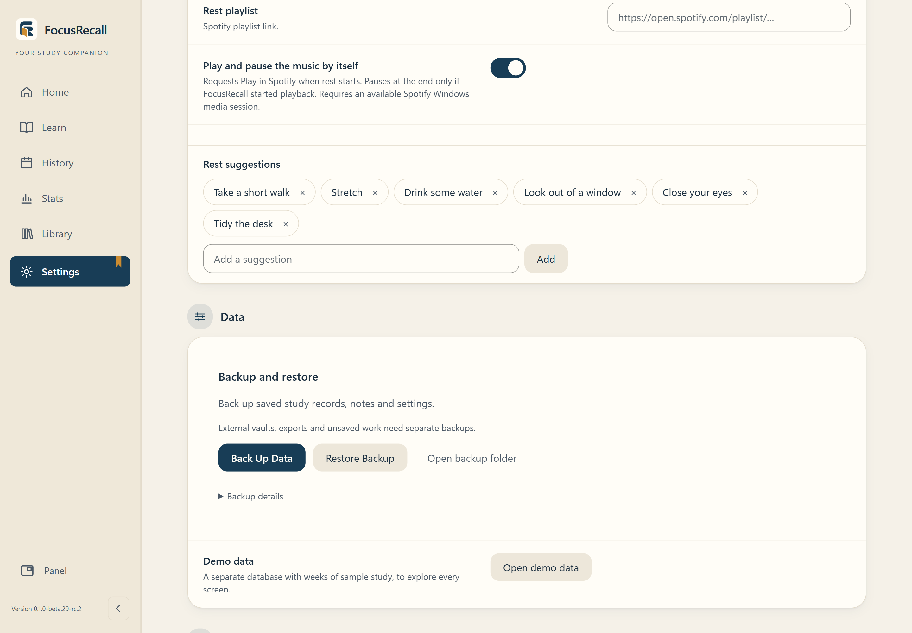

Before updating:

1. Finish any session in progress.
2. Select **Back Up Data** and keep a copy somewhere else.
3. Quit FocusRecall from its tray icon, then run the new installer.
4. Reopen it and check a recent session and your notes.

The installer is configured to retain your existing profile; real RC2 upgrade testing on a separate PC remains pending. Never delete profile folders or database files to fix a problem; see [troubleshooting](docs/USER_GUIDE.md#if-something-goes-wrong).

## Getting started

FocusRecall runs on 64-bit Windows. There is no public installer yet. If you have been invited to test, use only the installer and checksum you were given; the test build is unsigned, so keep Windows security on and report any warning you see. [Availability](docs/RELEASE_STATUS.md)

On first launch, choose Quick or Full Mode. Change the language in **Settings**. To look around before adding your own subjects, select **Open demo data** in **Settings → General → Data**: it opens a separate database of made-up study and leaves your own records untouched.

## More help

- [User guide](docs/USER_GUIDE.md): step-by-step instructions for every screen, plus troubleshooting.
- [Help and bug reports](SUPPORT.md) · [Security reports](SECURITY.md)
- [Source code and contributing](https://github.com/abd1442/FocusRecall-Dev)

Original FocusRecall code is licensed **GPL-3.0-only**. [License](LICENSE) · [Third-party notices](THIRD-PARTY-NOTICES.txt) · [Source information](SOURCE_NOTICE.md)

---

If FocusRecall is useful to you, you can support its development. It's optional and doesn't unlock anything.

  

