# Study with focus. Review what you learned.

**Focus. Recall. Understand your habits.**

FocusRecall brings focused study, active recall and personal analytics into one Windows workspace. Build a useful record of how you study while keeping control of your data.

**Windows x64 · Free to use · Closed-source · Local-first**

[**Download the Windows beta →**](https://github.com/abd1442/FocusRecall/releases) · [Report a problem or suggest an improvement](https://github.com/abd1442/FocusRecall/issues) · [How to use it](#using-focusrecall)

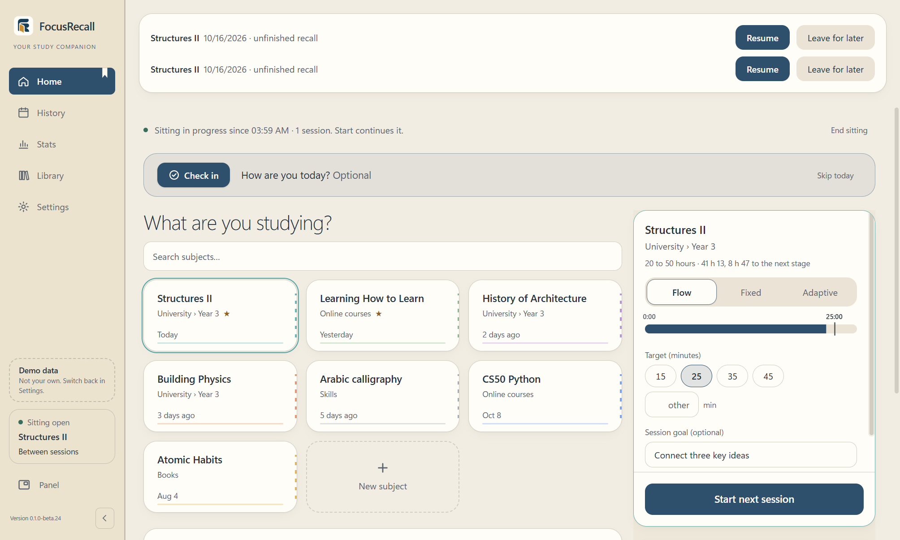

I built FocusRecall for myself because I couldn't find an app that combined the study tracking, recall notes and personal insights I wanted with the privacy I wanted. It is free to use, with no account or subscription required.

## Find your pace

| Flow | Fixed | Adaptive |
| --- | --- | --- |
| Count up and keep studying while you are engaged. | Count down from a target you choose. | Use your confirmed study history to help choose a target. |

Choose a subject and start. The floating panel keeps the timer and useful controls close while you work in another app.

| Before studying | During studying |
| --- | --- |
| 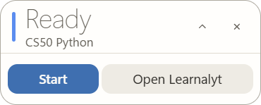 | 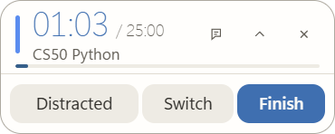 |

## Finish with more than a timer total

Recall the main ideas, connect them, and notice what is still unclear. Type or draw, use another notes app, or review with the optional timer. Then record the details you care about and choose a break before the next session.

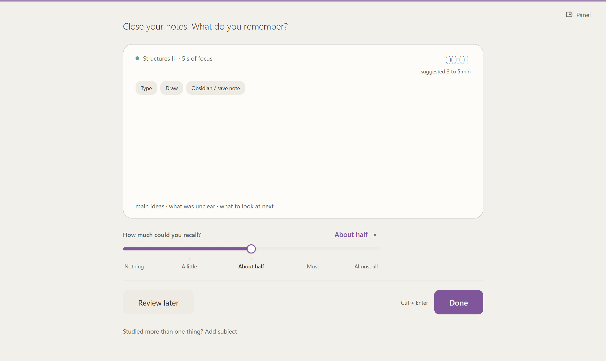

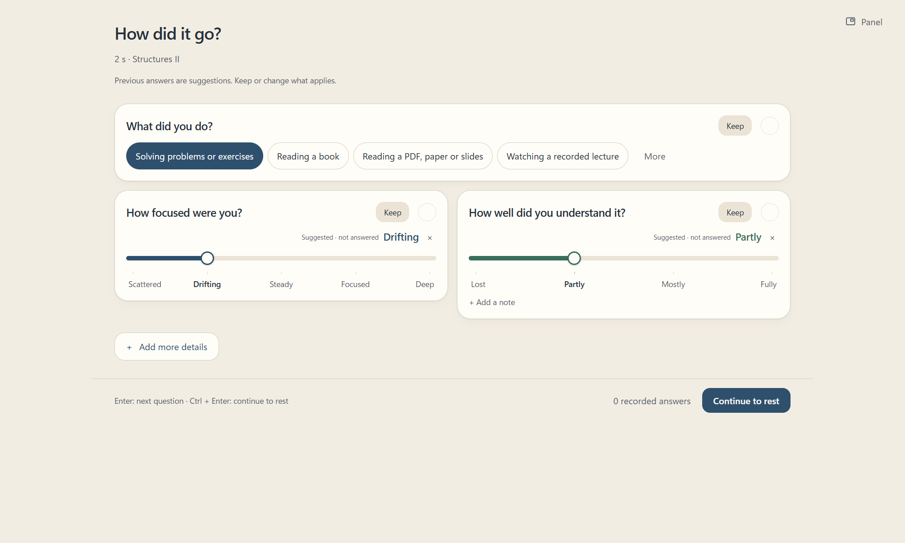

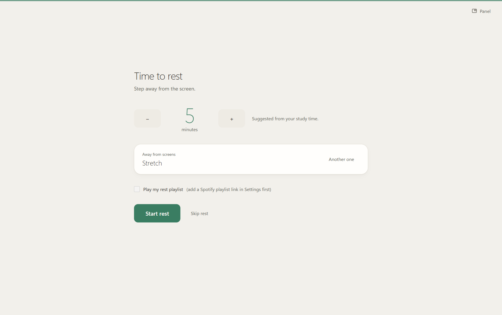

## Turn your records into better questions

See when you tend to report stronger focus, which conditions appear alongside better sessions, and what changed across comparable weeks. Open the supporting records, check the evidence grade, and optionally try a small experiment.

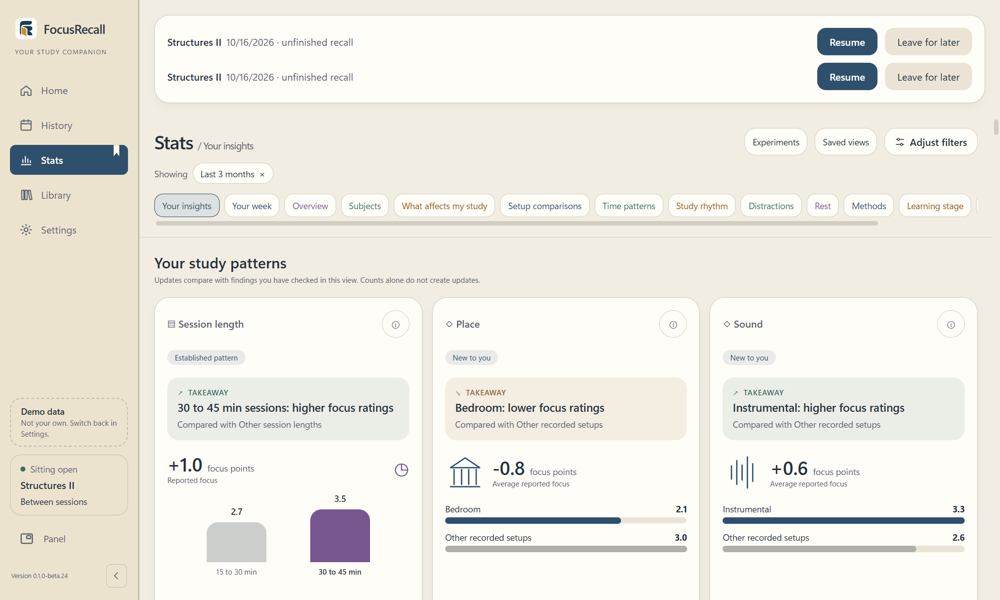

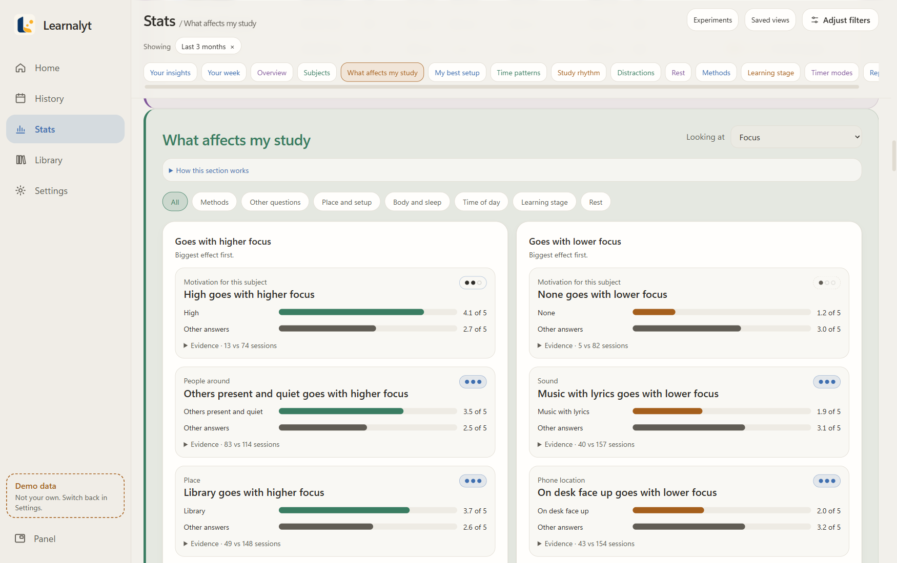

For example, higher focus ratings in the library can be a reason to try that setting again. More interruptions from your phone can show where to make a practical change. These are patterns in your records, not proof of cause or guarantees of learning.

## Keep the learning, not just the numbers

Search previous sessions, reopen recall notes and drawings, and return to unfinished questions. Save notes locally or explicitly export them to your Obsidian vault.

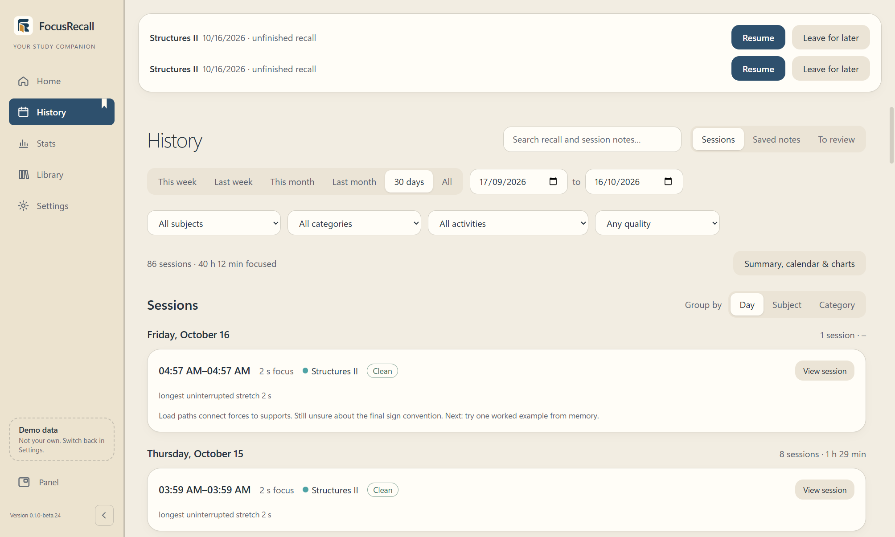

Automatic activity tracking can record study-time app and window activity locally. It is on for new profiles, can be switched off, and keeps existing users' choices. Your notes are sent to external apps only when you choose to export them.

## Install or update

1. Open [Releases](https://github.com/abd1442/FocusRecall/releases) and download the Windows x64 installer and SHA-256 checksums.
2. For an update, make a backup in Settings and close FocusRecall, including its tray icon.
3. Run the installer. Keep your existing installation scope and destination when updating. Choose a desktop shortcut if you want one.

The beta is currently unsigned, so Windows may show a reputation warning. Verify the official repository and checksum; stop if the file or warning is unexpected. Do not disable Windows security protections. Updates are manual; the app does not check for or download updates in the background.

## Using FocusRecall

Open a topic for illustrated instructions. For colours and corner styles, open **Make FocusRecall yours**.

Install on Windows

Download the EXE from [Windows releases](https://github.com/abd1442/FocusRecall/releases). Quit FocusRecall and its tray process before updating. Keep a verified backup of your records.

For a new installation, the guided installer offers **Only for me** by default, or **Anyone who uses this computer** with administrator approval when required. Choose the destination and desktop shortcut. For an update, keep the same installation scope and destination. Installing for all users does not combine their study records; each Windows account keeps its own profile. Do not change scope to move an existing profile.

The installer is unsigned. Use the checksum supplied with the exact release you download. Source updates and new screenshots do not change an existing release asset.

First-use guide

New profiles open a skippable first-session walkthrough. Choose Show me and follow hints pointing to real subject, timer and Start controls. The guide follows your own session through review, logging and rest, then shows History and Stats. It creates no sample study records. The guide explains automatic tracking and lets you turn it off before studying. Reopen it from Settings → General → Open starter guide. Existing profiles keep their tracking preferences.

Find your way

| Destination | Use it for |
| --- | --- |
| Home | Choose a subject, mode, target and goal; daily check-in, parked thoughts and yearly heatmap |
| Library | Categories, subjects, progress, resources and local notes |
| History | Review, search, correct or finish earlier study records |
| Stats | Personal insights, detailed analysis, Your week and report export |
| Settings | Defaults, questions, privacy, backup, appearance and hotkeys |

[Start studying](#start-studying) · [During study](#during-study) · [Recall-log-and-rest](#recall-log-and-rest) · [History and recovery](#history-and-recovery) · [Read your Stats](#read-your-stats) · [Notes and Obsidian](#notes-and-obsidian) · [Backups](#backups-and-restore) · [Troubleshooting](#troubleshooting)

*Home in the light theme. The compact year heatmap rests at the bottom of the visible left column. Flexible space separates it from the subject tiles; growing subject lists push it down naturally. Selecting a subject enables Start.*

Organize your Library

On Home, **New subject** needs only a name; category and progress unit are optional. New subjects use General and sessions unless you choose otherwise. In Library, **Add category** creates a grouping for subjects. Categories can contain subcategories. The menus provide rename, move/reorder, archive/restore and deletion actions. Pin a subject for convenient selection. Subject pages hold resources, notes, progress units/total, prior knowledge and learning-stage context.

*Categories group subjects; they are not individual sessions.*

Choose an appropriate progress unit such as pages or exercises. Progress is what you log, not a mastery estimate. Prior hours/knowledge help the app interpret learning stages; keep these approximate values honest.

Archive hides an item from ordinary active selection while keeping records. **Delete category** removes its grouping and moves subjects to the parent or Uncategorised; it preserves their history and notes. Other deletion actions can remove records: read the confirmation and take a backup before irreversible corrections. Block-owned notes follow a historical subject correction; subject-only notes stay with their subject.

Add a resource as a URL or file path. Opening it delegates to Windows or your browser. Local file paths work only where those files exist; avoid sharing private paths in issue reports.

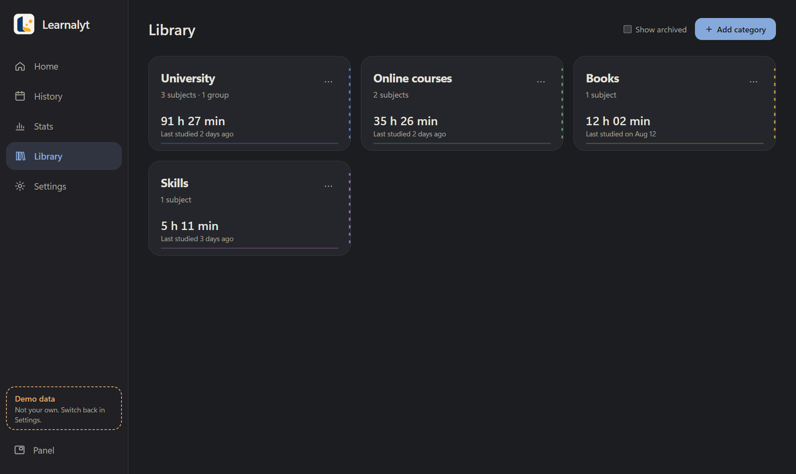

Start studying

Select a subject on Home and press **Start**. On smaller windows, a compact Start bar stays at the top; **Timer options** opens the full setup. Choose a mode and target, and optionally enter a small session goal. More options provide activity/setup context. The three modes offer different planning displays:

| Mode | What to expect |
| --- | --- |
| Flow | Counts upward toward the target and can keep going past it |
| Fixed | Countdown planning around a chosen target |
| Adaptive | Uses qualifying previous study to suggest a target; the UI distinguishes actual samples from example dots/defaults |

Adaptive is a planning aid, not a prediction of learning quality. The target is not a forced end to study. You control when to finish.

Press **Start**. With preparation enabled, a separate preparation sheet opens before time is recorded.

*Checks are optional and transient. They are not stored as completed habits.*

Tick anything useful and press **Ready to start**. To avoid repeating this panel, select **Skip preparation for the rest of this sitting**. This explicit choice applies to the current group of sessions while the app stays open; ending it or restarting restores preparation. **Review preparation** on the Next session screen opens it again. **Cancel** abandons the unstarted preparation while preserving the plan/goal. The timer starts only after Ready. The two defaults are phone away/silenced and distracting apps/tabs closed. Up to five extra checks appear only when your recent records show repeated positive focus or recall patterns for the selected subject and activity, such as a particular drink or study place. Blue side markers identify personal suggestions. Select **Why these?** for the supporting patterns. New or sparse histories show only the defaults. Water is not a fixed reminder.

Personal checks use active categorical setup/detail choices from the last 90 days, exclude untouched answers and mixed-subject sessions, and need comparable records on both sides across multiple days with the direction repeated over time. They describe associations, not proof of cause or health advice. Checks do not record answers, change your planned setup or log a drink automatically. Settings can disable preparation; older custom checklist text is retained in saved settings. General learning tips rotate separately from these personal checks.

The preparation sheet uses interface scale, independently of the small timer's size setting. It should return to the saved timer dimensions/position afterward. After changing display scaling, check the floating panel position on your chosen monitor.

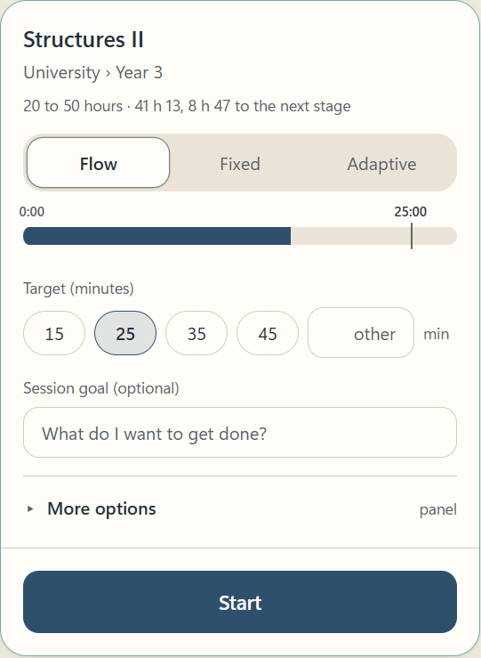

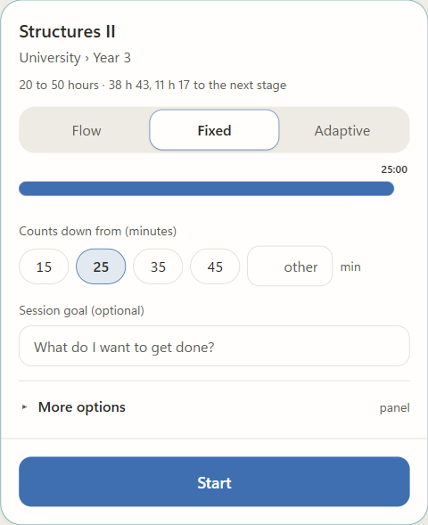

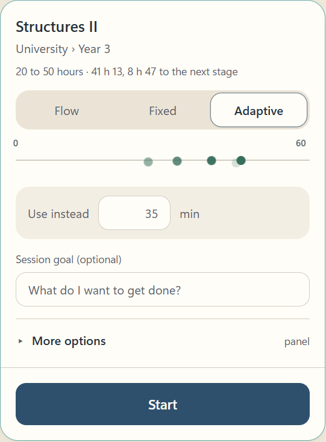

Floating controls

Keep FocusRecall within reach while you work in another app.

Press **Start** to prepare, then **Ready to start** to begin timing. Use **Distracted**, **Switch** and **Finish** from the running panel. Its thought icon parks a thought; the main study screen keeps only the three session controls.

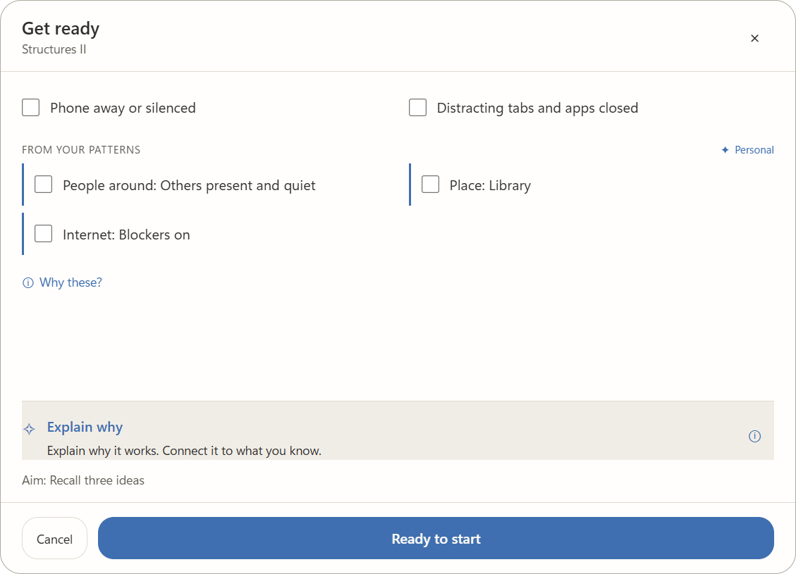

During study

*The short elapsed time is an actual fictional demonstration session, not a manufactured study result.*

**Distracted** pauses focused time; **Back** resumes it and can ask for a reason. A long absence may prompt you to continue or end where you left. Manual distraction recording works even when automatic tracking is off.

**Switch** changes subjects without ending the logical session. FocusRecall records separate subject parts with one continuing session/target. A sitting can contain multiple sessions and intervening rest. These distinctions matter when correcting timelines or interpreting comparisons.

**Park a thought** saves something for later without stopping the clock. Home, Focus and the expanded panel expose parked thoughts. Repeated exact text is grouped for presentation; original capture IDs/session links remain. Complete an individual oldest capture or explicitly complete repeats, then use Undo if needed. Search/expand to manage longer lists.

Optional **stuck** and **resisted distraction** markers record moments for later reflection. Enable/configure them in Settings. The floating timer and tray provide controls while you work in another app. Closing the main window during an active stage can hide it to the tray; use the tray to return or quit deliberately.

Default shortcuts are **F8** Distracted/Back, **F10** Switch and **F7** Park a thought. Stuck/resisted are unassigned by default. F9 is not assigned. Settings can change/disable shortcuts; another app may already own a key. While the main Focus screen has focus and no text input/dialog is active, Space also toggles Distracted/Back.

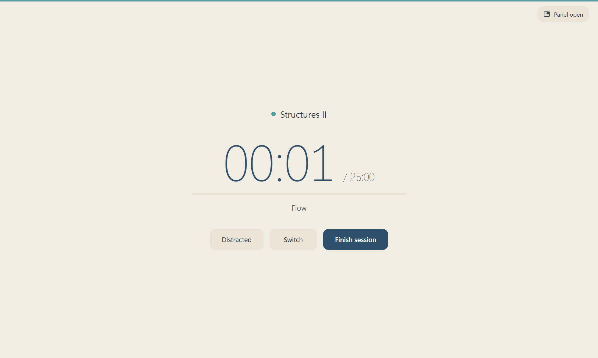

Recall, log and rest

Press **Finish session** to open **Review & connect**. Very short sessions first offer **Keep it / Discard**; Keep it preserves the actual duration.

Use **Start review** for a 1, 3 or 5 minute timer. Recall the main ideas and connect them to what you already know. Paper or another app works too. **Type notes** and **Draw notes** open FocusRecall's writing tools; writing is not required. **Skip review** goes to the log without inventing a recall answer. The recall rating is optional and starts unanswered. A short review suggestion changes between sessions. **Another suggestion** cycles through six general prompts without starting the timer or recording an answer.

**Continue to session log** opens the compact **How did it go?** log: activity, focus and understanding. **Add more details** expands one panel with progress, difficulty, goal outcome, timeline, setup, other questions and session notes. Daily check-in questions stay on Home.

Structured answers are remembered as suggestions for future logs. Confirm the ones that still apply; unconfirmed suggestions are excluded from ordinary insight evidence. Free notes and completed progress amounts are never copied into another session.

*Review on your own, or open the writing and drawing tools. Recall ratings start unanswered.*

Use **Type / Draw**. The whiteboard supports pen/highlighter/eraser, colours/widths and Undo/Redo/Clear; text and drawing can coexist. Recall text autosaves as you write; drawings remain editable stroke data with a preview. Mark something to review and optionally write what needs attention. **Save / send notes** opens a local/external note destination. Physical pen pressure/palm rejection depends on your device and remains a manual check.

If you forgot a subject switch, use **Studied more than one thing? Add subject**, then review the resulting dividers/times in the logging/timeline view. Do not treat the initial even split as your actual timing without correcting it.

*Questions depend on your configuration and scope. Answer what you want to use in later comparisons.*

Continue to the log and save activity, progress, goal result and selected question answers. Untouched/default answers are tracked separately; they are not automatically evidence of your opinion. Configure groups, fields, options, named sliders and question scope/frequency in **Settings → Log questions**. Previews are examples and do not write History.

**Continue to rest** opens rest setup before the countdown starts. Choose a duration and optional playlist, then **Start rest**. After rest, **Continue to next session** opens the subject confirmation screen. **Start next session** begins immediately; **Review preparation** is optional. **Finish studying** ends an active break and records its elapsed time. Record what actually happened or skip it. Planned rest is not measured recovery; rest comparisons use recorded actual rest. Continue to another session or end the sitting. Optional music/chime controls are in Settings and can depend on your Windows/media setup.

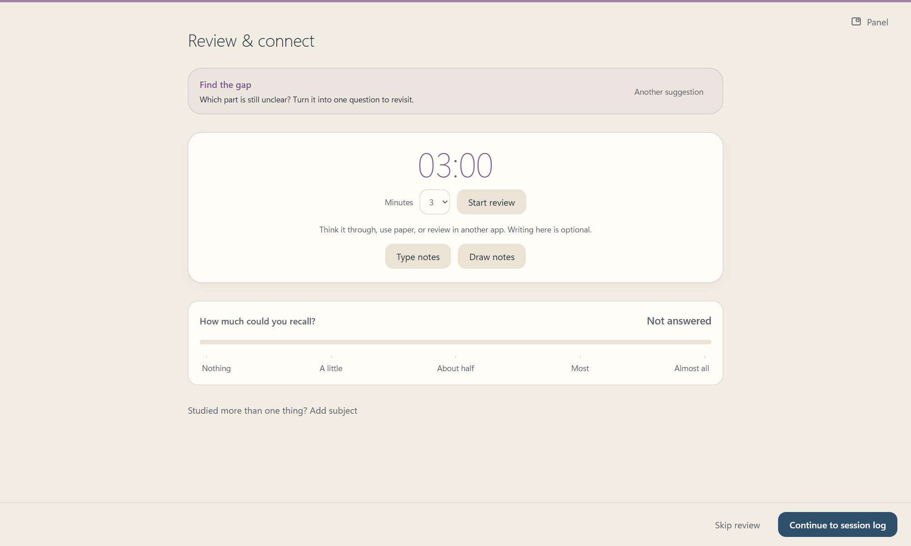

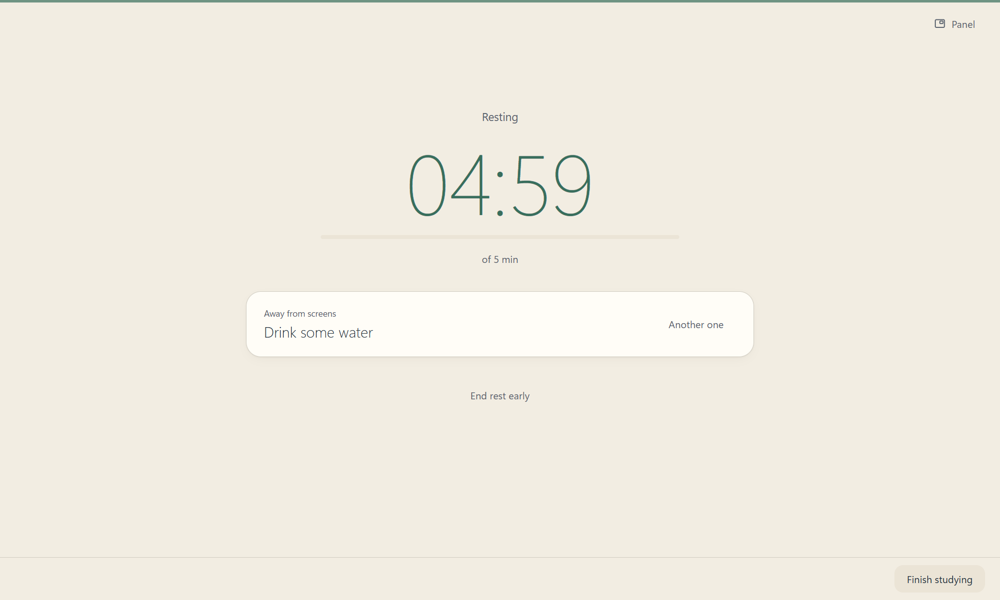

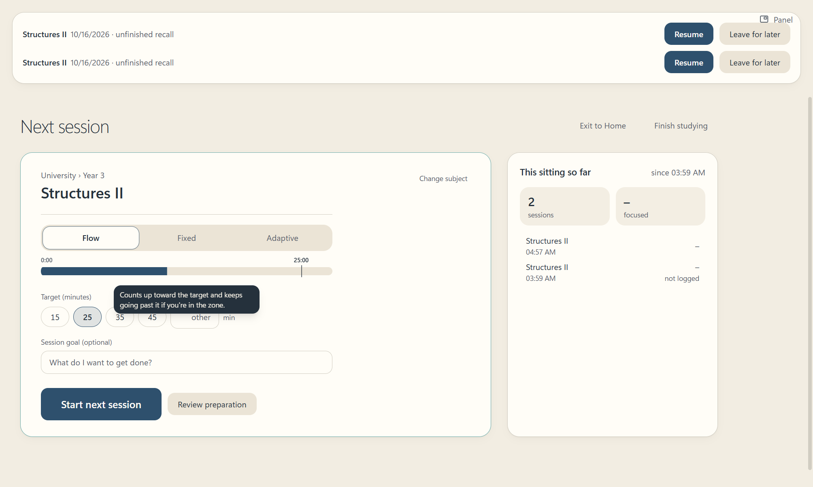

History and recovery

*Search and filters narrow records; review markers help find unfinished follow-up.*

History opens with compact, searchable session rows. **View session** reveals its timeline, answers and notes. **Summary, calendar & charts** opens the existing overview. **Saved notes** searches titles and text across all dates and subjects, including standalone notes; open a note or jump directly to its session. Session search and filters remain available, along with review flags, grouped log values and time corrections. Open a session to review recall/log/notes and its timeline. Correct timestamps/dividers or split a part when needed; pauses should intersect the actual subject extents. Delete only the intended part/session after reading its confirmation. Back up before substantial edits.

Subject corrections move block-owned notes atomically. Invalid dates are rejected before a correction commits. Subject-time totals use the actual parts, including switched sessions; outcome comparisons exclude mixed-subject sessions. Check the selected scope before comparing time and ratings.

After interruption, the app offers recovery for running work and unfinished recall/log/rest. Choose **Resume** to continue, or **Leave for later** to keep it pending in History. Persisted drafts survive restarts; unsaved forms elsewhere may not. Unstarted preparation is abandoned on restart without a study session. Recovery excludes application downtime. Related records and saved workflow state commit together, so a failed transition can be retried.

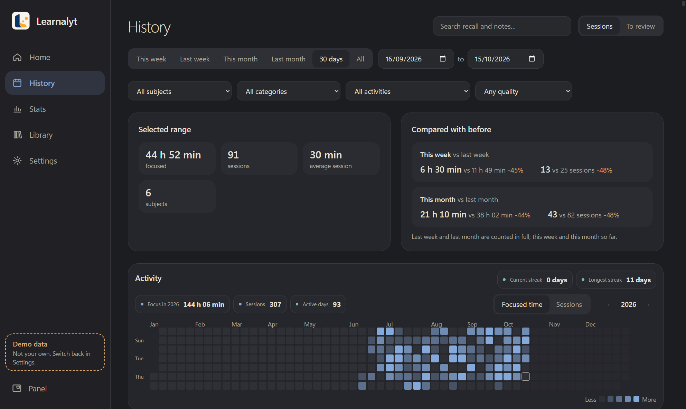

Check in and follow your study day

Use **Check in** on Home for daily answers, or **Skip today**. Daily fields and session fields can have different scopes. Change the study-day boundary and week start in Settings to fit your schedule. A study day can differ from the calendar date.

An unsaved check-in spanning rollover keeps an explicit choice between the old and new study day. History groups a sitting by its start day; daily statistics use part-start day, so cross-boundary views may differ.

*Use the year arrows and day details to explore recorded focused time. The heatmap is not a learning score.*

Read your Stats

*These associations belong to the generated fixture. They are not recommendations derived from your data.*

Stats opens with **Your insights**. Each card has a highlighted **Takeaway**. Select its info button for **Records → Match → Average → Meaning**, with the actual comparison and optional calculation details. The record-count button expands the supporting sessions/events and study days. Escape closes the walkthrough and returns focus to its info button. Rating differences are **focus/recall points**, not percentage gains in learning. Longer time does not mean better learning.

Evidence levels are **Not enough evidence**, **Early pattern**, **Repeated pattern** and **Well-supported pattern**. More comparable records, coverage across days and repetition over time support a higher level; a large session count alone does not. The highest level needs at least 20 observations and eight days on each side plus the existing matching, difference, outlier and repetition checks. These levels are not confidence percentages or guarantees. Distraction cards use the same four evidence labels, grading the leading recorded reason by event/day coverage, repetition across earlier and later days, and whether leaving out any one day changes the leader. Frequency and time lost are graded separately. Time-based grading counts only events receiving attributed time after overlap handling. The grade describes the recorded ranking, not unrecorded activity or confidence in a causal effect.

Answered outcomes are eligible by default; **include untouched** is an explicit analysis choice. Personal outcome comparisons exclude mixed-subject sessions. Pattern gates generally require five eligible observations on three days per side; stronger repeated patterns require twenty on eight days with consistent temporal direction. These are exploratory heuristics, not calibrated confidence or causal proof. Sleep comparisons operate at day/cohort level; duration comparisons account for mode/target; recorded actual rest is distinguished from planned rest.

Detailed sections remain visible: Overview, Subjects, What affects my study, My best setup, Time patterns, Study rhythm, Distractions, Rest, Methods, Learning stage, Timer modes and Report. Use the section strip on wider windows or the **Go to** selector on smaller ones. **Explore** opens the relevant question and outcome, highlights the selected option when available and keeps the original matched finding beside the chart. **Back to your insights** restores your previous question, outcome, filters and position. Each section has its own questions/outcome controls. A subject filter can mean **sessions containing that subject**, and detailed time attribution has an open mixed-session limitation. Library's subject-part totals and whole-session comparisons answer different questions.

Sparse or missing answers may yield no insight. Try recording consistent answers across several days rather than filling old defaults to make a chart appear. Large histories may take time to analyze; no universal instant-performance claim is made.

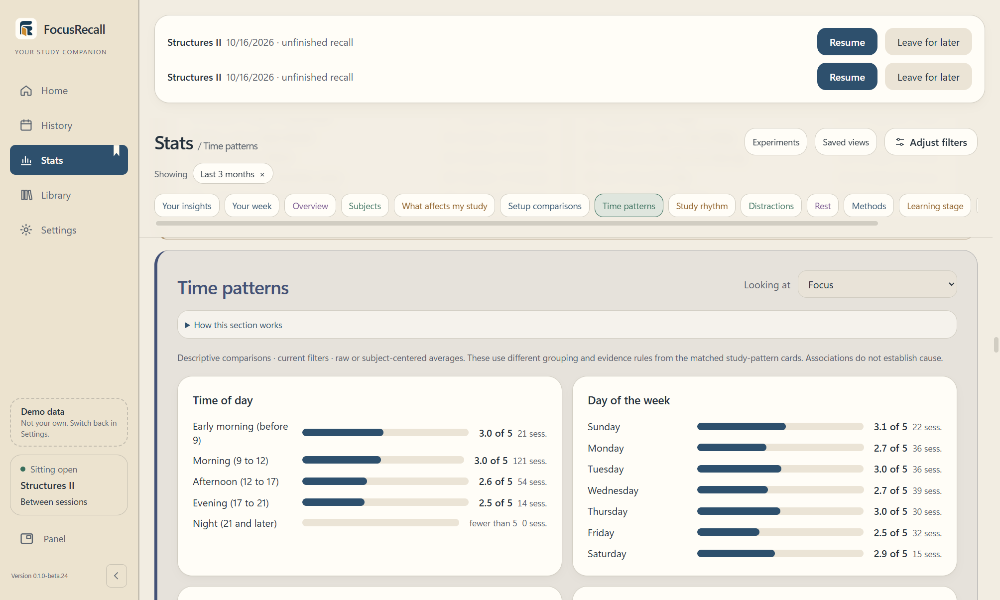

Your week, experiments and saved views

*Your week is an ordinary Stats section. The screenshot's in-progress week should not be compared as a completed week.*

Choose a week to see daily time, previous-week comparisons, subjects, answered outcomes and overlapping experiment results. Reflection is optional/collapsed. Review or edit the next-week experiment suggestion before saving; it is an idea, not a prescription. Weekly subject time buckets mixed sessions separately.

Open **Experiments** in the Stats companion to plan one change on one subject, with baseline/change/end dates, outcome and observations. Results use existing eligible logs and exclude mixed sessions; insufficient data suppresses a difference. Before/after differences can reflect other changes, so treat them as associations.

Use **Saved views** to save filters/analysis choices and the comparison outcome. Relative dates follow the calendar; custom dates stay fixed. Closing/switching the companion preserves drafts while Stats stays mounted; **save** for restart persistence. Removing a saved view/experiment removes the plan, not underlying sessions.

In **Report**, export PNG, Markdown or PDF. Preview the scope and inspect for private titles/notes before sharing. Reports are separate files and are not included in database backups.

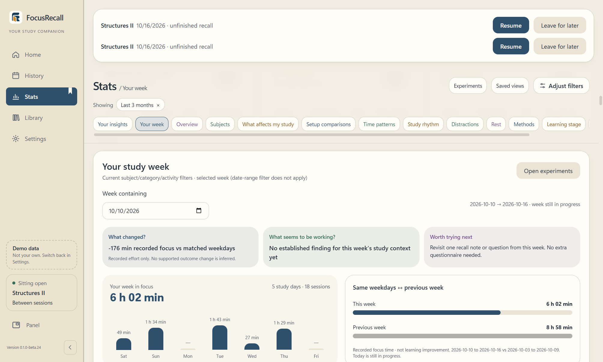

Notes and Obsidian

In **Library → subject → Notes**, choose **Write a note**, or open **Save / send notes** from recall. Type/draw, choose a destination and save. **Save in FocusRecall** keeps content locally. Expand **Obsidian options** to choose a destination, then explicitly select **Send to Obsidian**. The save status confirms success; unsaved changes are labelled. External sending saves locally first; failure leaves a local note for retry. Notes are not automatically sent to a cloud service. Notion synchronization has been removed; old local notes remain.

For Obsidian:

1. Choose the vault folder/name in Settings's Notes area or the editor. Use a disposable vault when testing.
2. Choose a Markdown file inside it or enter a relative file such as `Study/Practice.md`.
3. Optionally enter the exact heading. A missing heading can be created; blank adds at the end.
4. Select **Send to Obsidian** to write the FocusRecall entry and optional drawing PNG. Later sends update its marked entry while retaining unrelated file content.

Keep FocusRecall's HTML markers if editing the file manually. Direct writes reject parent traversal and linked paths. Back up your vault separately, particularly if another app edits the file concurrently. Obsidian need not run for file writes, but its installed URI handler and vault name must work for **Open external note**.

Changing a destination clears its old external link. A new link becomes available after a successful send. Retry a failed send after resolving access/path problems; the local note remains saved.

Backups and restore

Search Settings for **Back Up Data**, **Restore Backup** or **Open backup folder**. Back Up Data creates and validates a SQLite snapshot while the app is open. Before pending migrations, FocusRecall keeps the latest three successful automatic snapshots; manual/safety backups are not automatically pruned.

Restore validates integrity/schema/relations, rejects incompatible/corrupt backups, asks for explicit confirmation, takes a safety snapshot and restarts. Finish or leave active workflow work for later and wait for note writes first. Restoring replaces newer database content with the selected backup; save work and keep the safety backup.

| Included in database snapshot | Back up separately |
| --- | --- |
| Saved sessions, subjects, recall/logs, local notes/drawings, settings/presets and tools | Obsidian Markdown/PNGs, exported reports, `config.json` demo choice, Chromium/Windows state, unsaved forms |

Normal profile: `%APPDATA%\Learnalyt` (or the retained legacy `%APPDATA%\trifocus` profile). Backup folders are `backups/<database-name>/automatic`, `manual` and `safety`. Personal/demo backups are separate. Never delete live WAL/SHM files or manually replace an open database. A startup failure does not reset data; keep the folder/backups and use the offered backup-folder access. If a database cannot be opened, keep the original data folder and backups and contact support before replacing files.

Appearance and settings

*Search jumps to relevant controls; illustrated samples do not become study results.*

Use **Appearance** for light/dark/system, independent accents, high contrast, timeline colours, interface/writing/panel sizes, fonts, shape and density. Expand custom options for exact colours/fonts and saved presets/import/export. Custom low-contrast combinations can warn. Installed fonts depend on your computer. Timeline colours apply consistently across subject history/live bars. Reduced-motion behavior follows Windows preferences.

Choose interface size to enlarge the app; writing size and timer panel size are independent. The default timer-mode setting includes real/examples distinctions for Adaptive. Question previews and rest calculators teach behavior without modifying your records. Form dialogs contain keyboard focus, support Escape and restore focus on closing.

Automatic tracking starts on for new profiles, with a visible switch in the skippable first-use guide. Existing choices are preserved. Foreground process/window titles can be recorded locally; they may contain sensitive names. Disabling stops collection and keeps previous records. Do not attach window-title history or a personal database to a public issue. Local-first does not mean encrypted.

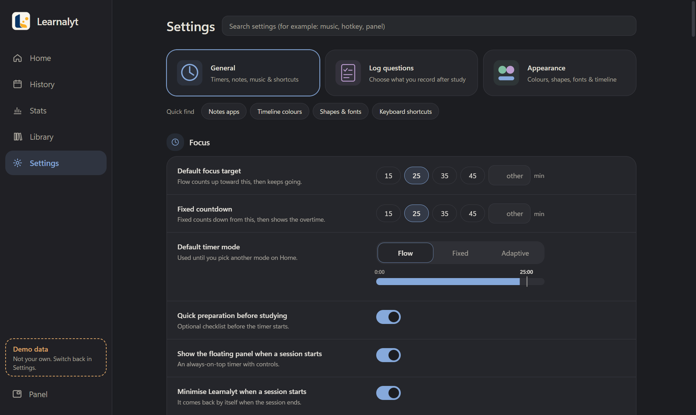

Study reminders

In **Settings > Study reminders**, enable either type independently. Both are off on a new or upgraded profile:

- **Daily study reminder:** choose a local time. While you are active on the PC and free of study/rest, one notification can appear at that time or within the following hour. It does not replay missed days. Your chosen daily time can be at night; personal quiet hours do not override it.
- **Personal study reminders:** an occasional prompt during a two-hour window associated with higher answered focus ratings in the last 90 days. The comparison balances recorded subject/activity groups and must repeat in earlier and later records. With insufficient, stale or conflicting evidence, no personal reminder appears. Windows are associations, not guaranteed best times or medical advice.

Personal reminders are limited to one per local calendar day. All automatic reminders have a four-hour gap between attempts. A personal reminder is held back near the daily time. **Quiet hours** affect only personal nudges; **Pause 1 hour**, **Pause today** and **Resume reminders** affect both. Pauses and delivery-attempt history survive restarting the app, including after Windows declines a notification. A failed attempt is not repeatedly retried that day.

No reminder is sent during focus, preparation, recall, logging, rest, an open sitting, a locked/idle PC, or while you are using FocusRecall's main window. Activity detection uses only Windows active/idle status; it does not read app names or window titles and does not enable foreground tracking. Reminder text contains no subject names or note contents. Clicking a notification opens FocusRecall without starting a timer.

With either reminder enabled, closing the window keeps FocusRecall running in its tray. **Quit** in the tray stops reminders. Open the app again after Windows restarts; no login startup task or OS scheduled wake-up is installed. Reminders cannot run when FocusRecall is fully closed or the PC is asleep.

Use **Test notification** to check delivery without consuming your daily reminder. Windows notifications, sound permissions, Do not disturb and installation identity can affect what you see or hear. An OS delivery acknowledgment does not prove a banner was visible. Reminders remain local and use no network service.

Troubleshooting

| Problem | Practical next step |
| --- | --- |
| Start unavailable | Select an active subject; resolve current/recovered work first |
| Timer seems to disappear | Return through tray/Panel; check minimize/automatic panel preferences |
| Shortcut does nothing | Check Settings and conflicts with another Windows app |
| No insight appears | Check filters, answered coverage and sufficient observations across days |
| Unexpected subject total after a switch | Check actual part times and selected filters in History and Stats |
| Note send fails | Local copy remains; check vault permissions/file/heading and retry |
| External note does not open | Verify the destination, successful send and installed Obsidian URI handler |
| Data seems missing after update | Keep `%APPDATA%\Learnalyt` (or the retained legacy `%APPDATA%\trifocus` profile); check personal versus demo mode and do not reset/delete files |
| Startup cannot open data | Keep data and backups; use backup-folder access and request help with a fictional reproduction |
| Windows warns about publisher | Current installer is unsigned; obtain approved distribution/build provenance and do not disable protection |
| No reminder appears | Enable a reminder, leave FocusRecall running in its tray, return to an active/unlocked PC and check pauses, Windows notifications and Do not disturb. Personal nudges also need sufficient focus records; use Test notification to check delivery |

For a bug, include version, Windows version, timer mode and minimal fictional steps. Redact screenshots; never upload your database, vault or secrets. Read [Help and feedback](SUPPORT.md) before reporting a problem, and [release notes](RELEASE_NOTES.md) for current limitations.

Save and revisit useful findings

In Stats, use **Save finding** to keep a useful discovery, **Hide** to set it aside, or **Mark checked** to remember that you have reviewed it. Hidden findings can be restored. Your choices only affect the display, not your study records or the analysis.

Badges distinguish **New to you**, **Established pattern**, **Updated finding**, **Less support now**, and **Direction changed**. An update needs a meaningful difference and additional records across more days; extra counts alone do not create one. These labels compare the same question and view with the evidence you last checked. They are not alerts or proof of learning improvement.

After saving a finding, use the compact **Saved findings** button beside Your study patterns to revisit it. It recalculates current evidence when you return to that view. **Open original view** restores a finding's date-range preset, subject/category/activity filters and analysis options. Rolling presets move with time. The saved snapshot retains the period you originally checked. If the current window or eligibility rules no longer support a comparison, the old conclusion is shown as historical evidence without a continuing recommendation. A bounded candidate search can also make a comparison unavailable.

A weekly decision

**Your study week** now begins with **What changed?**, **What seems to be working?**, and **Worth trying next**. It keeps the detailed charts, outcome coverage, experiments and optional reflection below. Recorded time is effort, not mastery. Outcome changes use matched subject/activity comparisons and confirmed answers. A repeated pattern may use up to 90 days ending in the selected week; its own dates and sample counts remain visible. Before starting another change, review an existing experiment and your previous weekly next step.

Small experiments and earlier learning

An insight-based experiment preselects its original subject/activity only when there is one valid context. Otherwise choose among its original contexts. Existing records provide the baseline. Advanced dates, outcomes and controls remain available. Progress reports matched answers, study days and whether the intended condition was confirmed. A finished trial can remain inconclusive. Before/after differences are associations, not proof of cause.

For early histories, Stats shows recorded sessions, answered ratings and available recall/progress records without filling gaps with advice. In History, open a previous session to revisit its recall notes or something you marked for review. This is optional, uses existing records, and creates no review schedule or extra questions. History keeps the original session and subject context.

About and optional support

Open **Settings → About** for the story behind FocusRecall, local-data privacy information and feedback links. [Ko-fi support](https://ko-fi.com/abd442) is optional. FocusRecall remains free. Opening a support link uses your browser only when you click it.

### Timer options in smaller windows

Use the top subject picker and **Start** button. **Timer options** opens a compact dropdown directly below the bar. Choose Flow, Fixed or Adaptive and a duration. Open **More options** for the goal, planned activity and setup. Escape or a click outside closes it without losing your choices. Wider windows retain the side panel.

Make FocusRecall yours

Open **Settings → Appearance**. Use **All light**, **All dark**, **Light sidebar / dark**, or **Dark sidebar / light** to browse the visible palette grid, then select a palette card. Each group includes its defaults, reference choice and Sage variants. The bookmark contrasts with the selected navigation button.

**Follow Windows**, at the top right of Colours, switches with your Windows theme. Turn it off to keep the current appearance. Palette cards select a fixed appearance. Existing saved themes and settings remain compatible.

Use the sidebar chevron to switch between the expanded sidebar and the compact icon rail. Fonts, writing size, shapes, spacing, individual colours and named presets remain available. Theme changes apply throughout the app without changing study records.

All examples below are captured from the same Windows beta with fictional records. Change colours and corners independently; your study data stays the same.

### Straight or rounded

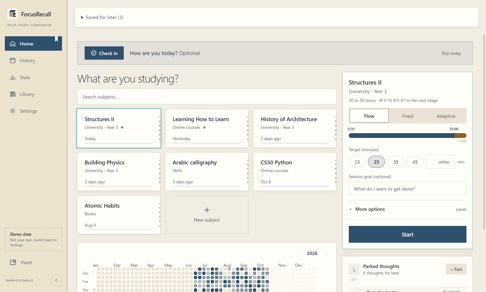

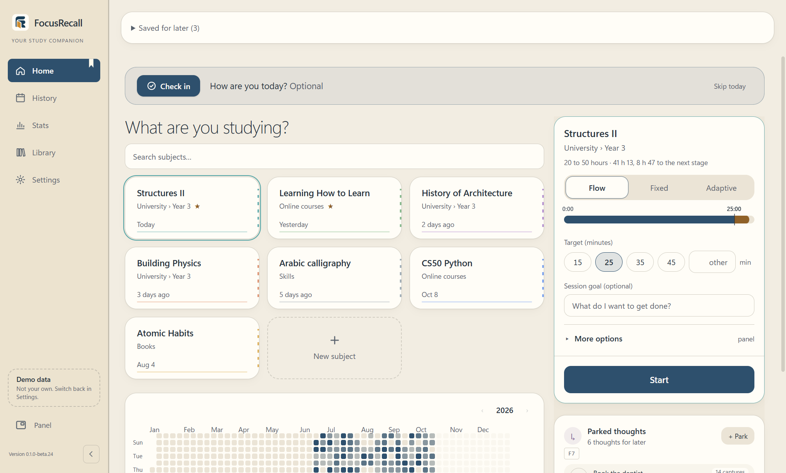

### Light, dark and mixed workspaces

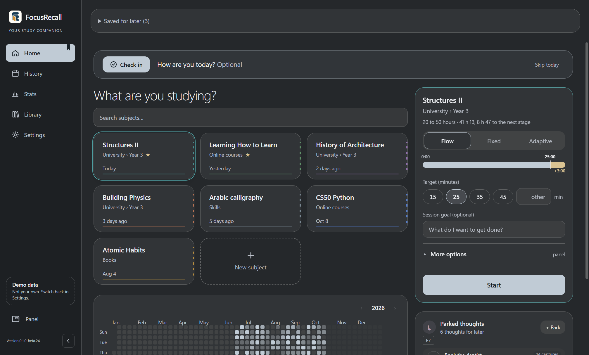

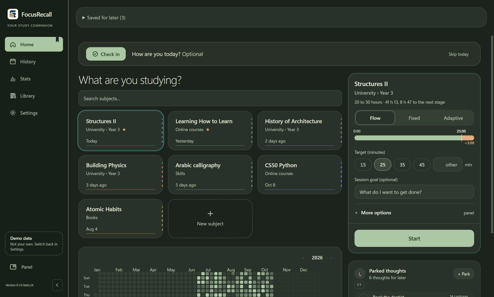

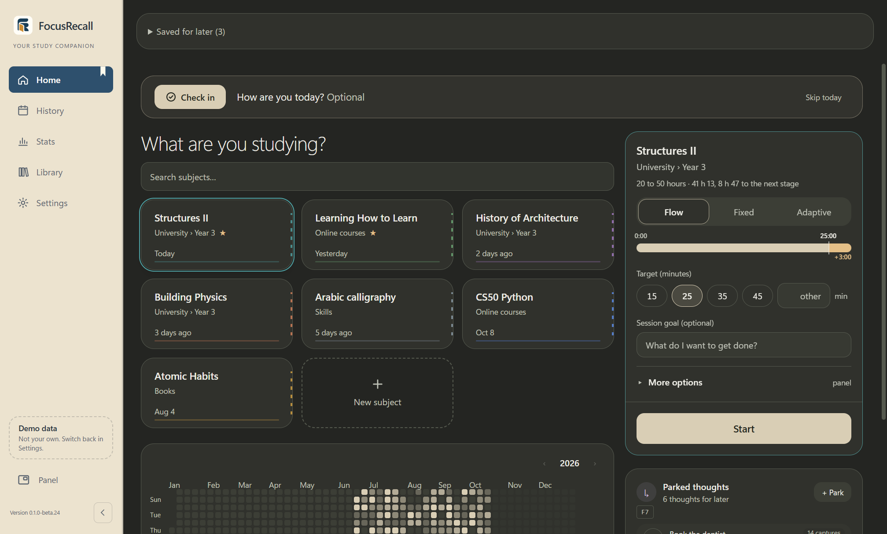

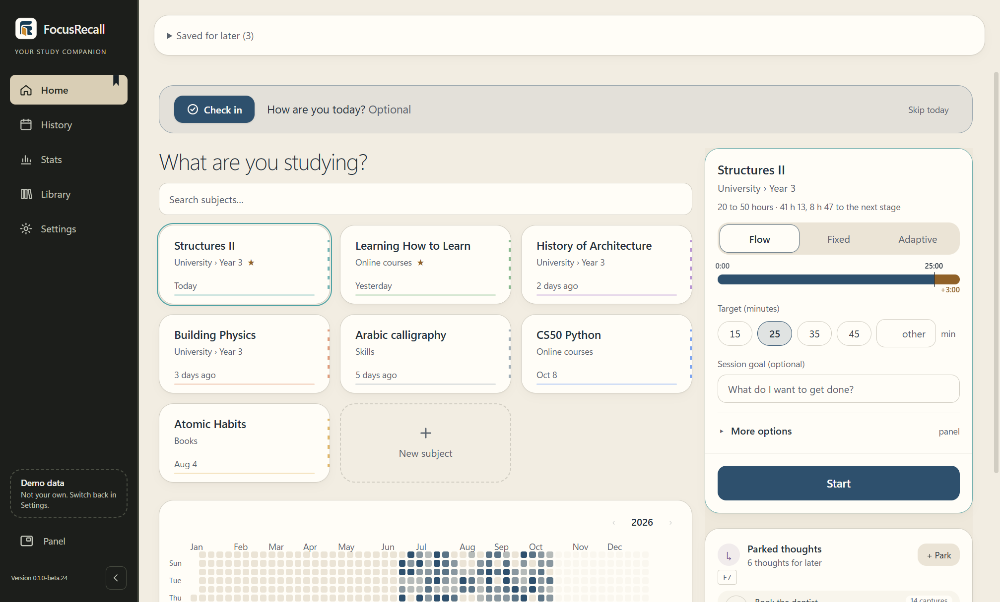

### More colour choices

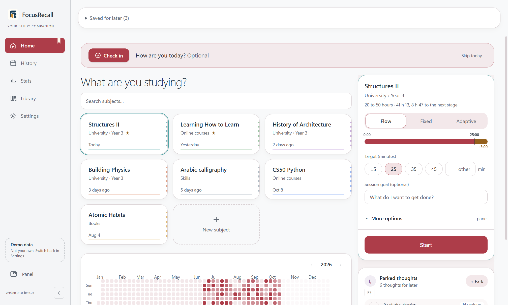

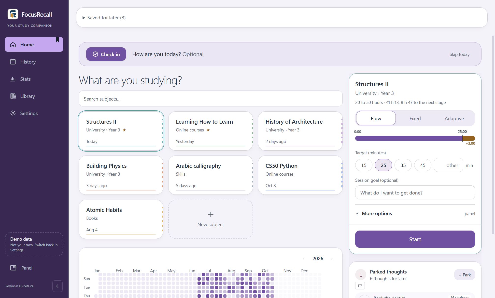

## Your records stay under your control

Study history, settings and notes are stored locally. Local backups may contain personal information; keep them somewhere secure. Optional exports and integrations act on your request. [Privacy details](PRIVACY.md) · [License](EULA.txt) · [Third-party notices](THIRD-PARTY-NOTICES.txt)

FocusRecall is free, proprietary software. Donations are optional and do not unlock features.

[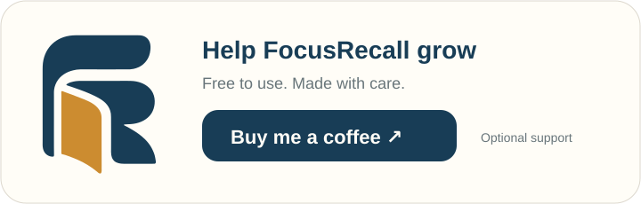](https://ko-fi.com/abd442)
