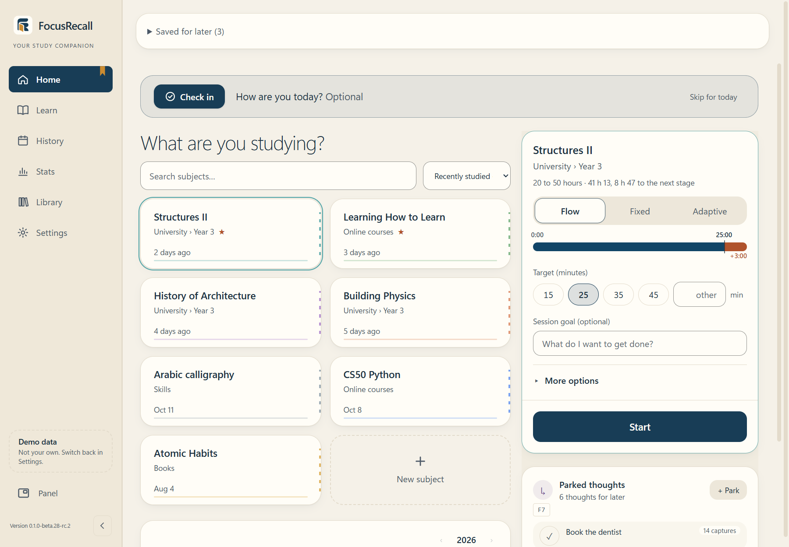
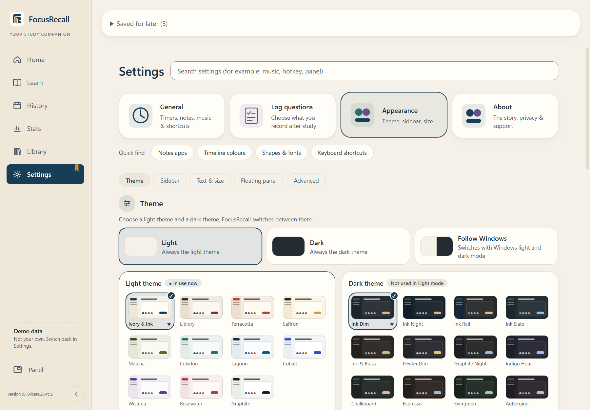

# FocusRecall

A local-first Windows workspace for focused study, recall notes and thoughtful review of your own study records.

**Pre-release · Windows x64 · GPL-3.0-only · No required account**

Current source and installer: **0.1.5-beta.2 — Beta 2**, an unsigned Windows x64 prerelease. See [release status](docs/RELEASE_STATUS.md) for verification and limitations.

## What it does

- Organize subjects, use manual or automatic subject sorting, and choose Flow, Fixed or Adaptive timers.
- Move through preparation, Focus, Recall, session logging and Rest with compact floating panels.
- Keep history, recall notes and drawings; explicitly export notes to Obsidian when wanted.
- Inspect time, conditions and self-ratings in Stats, with uncertainty and observational evidence limits.
- Explore research-informed Learn content independently of personal ratings.
- Choose from 26 approved themes, separate light/dark preferences and seven languages: English, Arabic, Spanish, French, Simplified Chinese, Brazilian Portuguese and German.

Immediate focus/recall ratings describe recorded experience. They do not demonstrate retention, mastery, causation or which study method is best for you. General guidance and personal observations remain distinct.

## Privacy and timing

Study records stay local. Foreground-window monitoring is **off by default** and needs explicit informed opt-in. Window-title collection has a separate choice; stored titles can be deleted without deleting study history. Existing backups/exports may still contain them. Local storage is not application-level encryption.

Screen lock, sleep and uncertain unobserved gaps interrupt observed study timing; unobserved time is not automatically credited. Updating does not require deleting your profile. See the [user guide](docs/USER_GUIDE.md).

## Interface preview

Genuine current-interface renders use an identified QA build and fictional records. They do not verify a clean Windows installation or clear artwork rights. [Capture details](docs/screenshots/current/manifest.json).





## Build and contribute

Use Windows x64, Node.js 24, Python, MSVC C++ build tools and the Windows SDK. Native compilation also needs matching cached Node headers; exact commands are in [SOURCE_BUILD.md](SOURCE_BUILD.md).

```powershell
npm ci
npm test
npm run build
```

After dependencies/headers are prepared, `npm run build:win` creates a development installer under `dist/development/`; follow SOURCE_BUILD.md's certificate-discovery setting for an unsigned build. No build command installs or publishes it. Use an explicitly isolated fictional data directory for development or QA. [CONTRIBUTING.md](CONTRIBUTING.md) explains setup, checks and the separate inspector-enabled build.

CI checks contracts, notices, seven-language copy, tests, builds and repository/source-export hygiene. It does not certify installation, physical sleep/wake, assistive technology or scientific validity by itself.

## License and support

Original code is **GPL-3.0-only**; see [LICENSE](LICENSE). Third-party notices retain their terms. GPL licensing does not establish rights to unverified artwork: [asset review](docs/ASSETS.md). Binary distribution must provide matching Corresponding Source and required dependency sources under GPLv3; a private repository URL alone is insufficient.

For bugs, provide the version, Windows version and a fictional reproduction. Keep databases, backups, private notes and window titles out of issues. Report vulnerabilities privately as described in [SECURITY.md](SECURITY.md).
