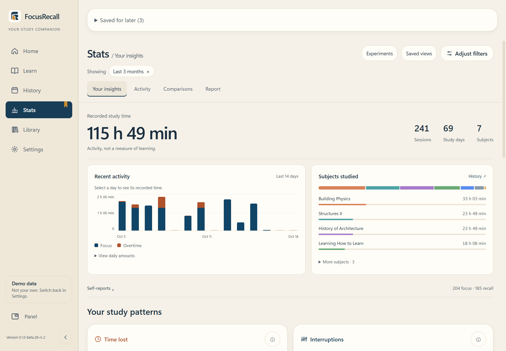
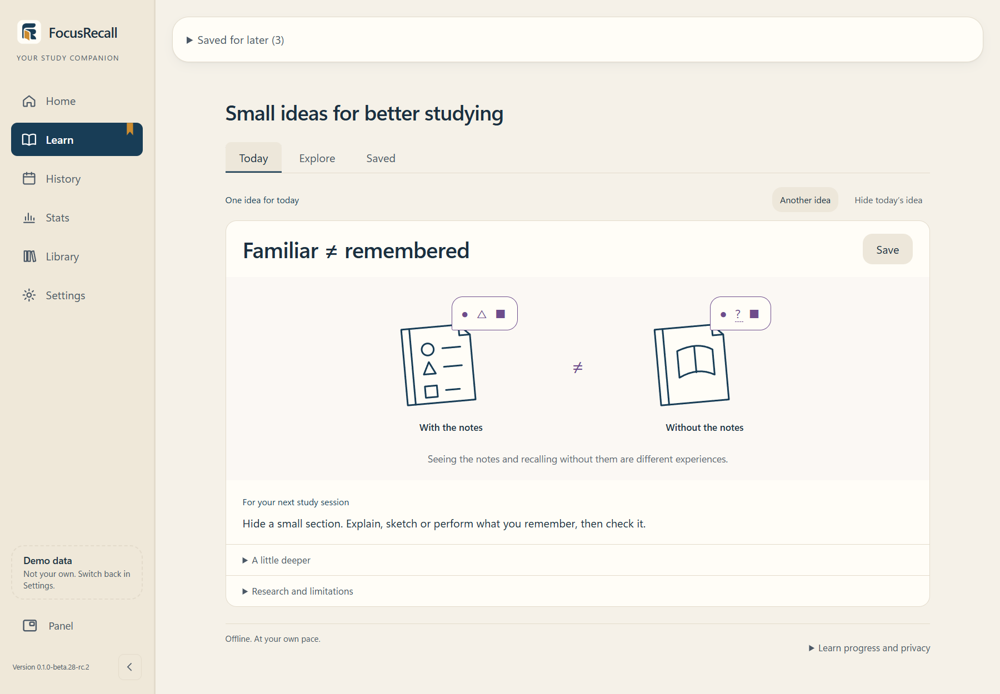

# Using FocusRecall

This guide describes beta.28-rc.2. It is not download authorization; read [release status](RELEASE_STATUS.md). Captures use fictional records and an identified QA build.

## Install or update

Use only an explicitly supplied controlled-test installer and its exact checksum. The candidate is unsigned: record unexpected Windows/antivirus warnings and stop rather than disabling protections. Do not treat an old GitHub asset as current.

Before updating, create a verified backup in Settings and finish/close FocusRecall, including its tray process. Keep the existing scope/destination. Installing for all users does not combine their records. Never delete AppData, databases or WAL/SHM files to resolve an update. Stop on a data-opening error and preserve original files/backups.

## A study cycle

1. Create/select a subject on Home. Sort beside Search offers manual order, alphabetical, recently studied and most studied when history supports them. Manual movement has keyboard controls.
2. Choose Flow (count up), Fixed (your target), or Adaptive (a target informed by recorded history). Complete optional preparation and begin Focus.
3. Use the floating panel while working. Mark distractions or pause. Locked/asleep/unobserved time is not automatically credited; resume on return.
4. Finish Focus and recall what you can. Use notes/drawings, review or an optional recall timer. A timer total is not a learning score.
5. Complete optional logs/ratings, choose Rest and continue when ready. History keeps the details.

Today Check is optional. **Skip for today** hides it until the next local calendar day. The permanent Settings Show/Hide preference takes precedence; neither erases history.

## Read Stats carefully

Stats distinguishes recorded activity/time, immediate self-ratings and observational comparisons. Open supporting records and the evidence/uncertainty explanation. An exploratory association may reflect time trends, missing data or other conditions; it is not causal evidence. Unavailable evidence, no association and no records are different states.

Method comparisons describe how sessions were rated. They do not establish lasting recall, mastery or method superiority. Self-ratings cannot prove durable learning. General research guidance is separate; users can still compare their recorded experiences.

## Learn and appearance

Learn offers illustrated explanations and 24 canonical strategies, with context and research limits. Browse/save ideas freely; it is not a mastery assessment.

Appearance offers 26 approved themes, independent light/dark choices and system switching. Existing custom Focus colours and legacy preferences migrate. Darkroom's documented colour-vision exceptions are not a blanket accessibility guarantee. Arabic supports RTL. Automated keyboard/ARIA checks are not screen-reader certification.

## Privacy and backups

Automatic foreground monitoring starts **off**. Read its disclosure before enabling it. Title collection is a separate opt-in because titles can be sensitive. Blocked monitoring is not evidence of distraction-free study.

Historical title deletion preserves study history and recorded classification provenance, turns title collection off, and cannot erase existing backups/exports/synced copies or disk remnants. An older restored backup can restore titles/settings. No forensic erasure is promised.

Data is local, without application-level encryption. External links/integrations involve other software/services. Notes are written to an Obsidian destination only when explicitly requested; back up vault files separately.

Use Settings → **Back Up Data** and confirm verification succeeds. Preserve originals/backups on a recovery error. Routine bug reports need fictional steps, exact version/Windows build and cropped nonprivate screenshots, not a profile folder. See [SECURITY.md](../SECURITY.md).
