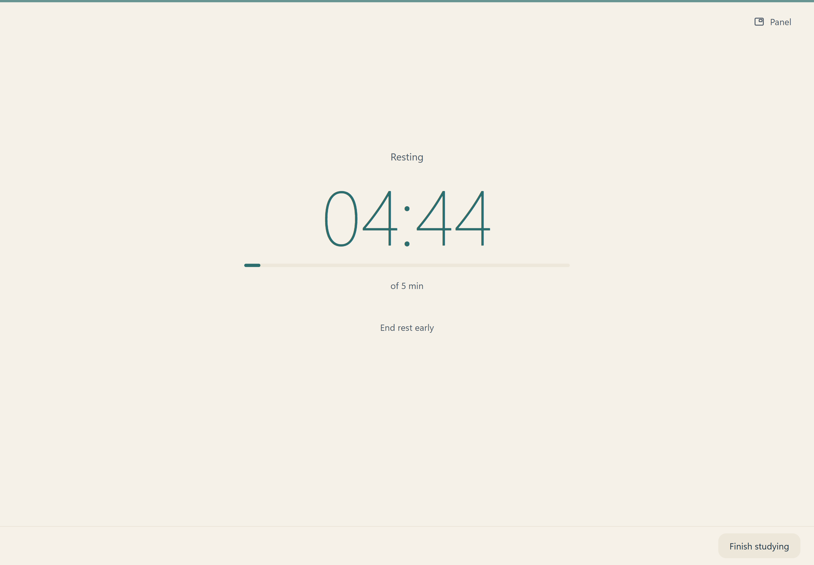
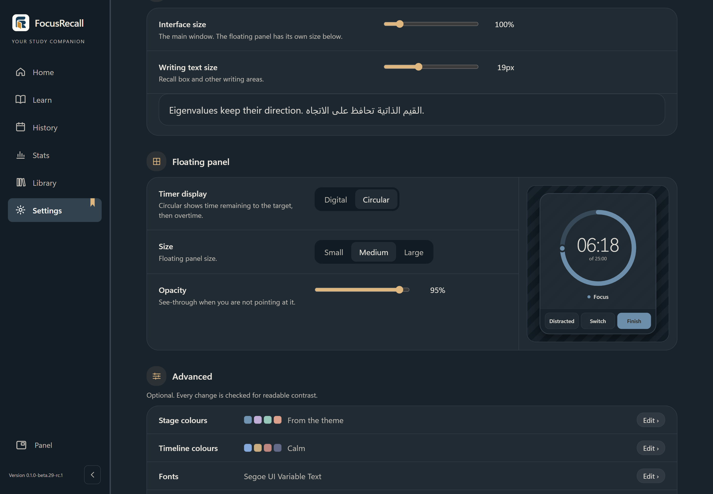

# Your first sessions with FocusRecall

Choose **Quick Mode** for a timer with minimal steps, or **Full Mode** for Focus, recall, logging and rest. Both share subjects and history.

FocusRecall records time spent studying each subject and stores session notes and history. Notes, ratings and window tracking are optional.

This guide describes **beta.29 RC1 on Windows**. Screenshots use fictional subjects and notes. See [availability](RELEASE_STATUS.md).

**On this page:** [First session](#your-first-study-session) · [Home tools](#home-tools) · [History](#find-your-sessions-and-notes) · [Stats](#read-stats) · [Learn](#learn) · [Appearance](#appearance-and-language) · [Privacy](#choose-what-you-record) · [Backups & updates](#install-update-and-protect-your-records) · [Troubleshooting](#if-something-goes-wrong)

## Your first study session

Choose the study experience during first-time setup. You can switch in Settings between sessions. Existing profiles remain in Full Mode initially; switching does not erase or rewrite history.

### Quick Mode: start and continue

1. On Home, create or select a subject. The plan card shows its target and timer mode. Open **Timer options** to change them, then select **Start**. The floating timer opens automatically.
2. **Pause** stops the clock; **Resume** continues it. **Next** saves and immediately starts another session on the same subject. It does not start another session automatically when the target is reached.
3. To change subjects without ending the session, select the subject name and chevron on the floating panel, choose the next subject and confirm **Switch now**. Each subject retains its own time.
4. While paused, **Break** saves the session and offers a break timer. **Break over** does not automatically resume studying: choose **Resume** when ready.
5. **Finish** saves and stops. No preparation, recall, log answers or rest are required; skipped activities are not filled in for you.

The main window is also a keyboard-accessible alternative for Pause, Resume, Next, Break, Finish and Switch. **Show timer** brings back the floating panel.

### Full Mode: a complete study cycle

The following steps describe Full Mode. Writing notes, answering ratings and taking a timed rest are optional.

#### 1. Choose a subject and one small goal

Open **Home**, select **New subject** and enter a name you will recognize later, such as “Biology.” Select its card to see the timer controls. You can organize subjects into categories; you do not need to plan your entire course before starting.

Write an optional session goal: “Explain how water moves through a plant” is more specific than “Study.” The goal stays with the session so you can return to it later.

*The selected subject's controls sit beside the subject list. Search and sorting share one row.*

Choose a timer:

- **Flow:** counts up, with a target marker. Useful when you want room to continue while the work is going well.
- **Fixed:** counts down from your chosen target. Useful when you have a set amount of time available.
- **Adaptive:** suggests a target from eligible past sessions on the subject, using your default until enough are available. You can override it.

The target helps plan time. Choose a comfortable duration, then select **Start**. If preparation is enabled, confirm the **Get ready** panel before beginning.

**Today Check:** answer it if useful, or choose **Skip for today**. That hides it for the rest of the local calendar day, including after a restart. The permanent Show/Hide preference in Settings takes precedence and does not erase previous check-ins.

#### 2. Work with the floating timer

Study in your usual book, browser, editor or on paper. Open **Panel** if you want the compact timer beside your work. Drag it to a comfortable position.

In **Full Mode**, use these controls:

- **Distracted** marks time away from studying; **Back** resumes the focus clock. Use it when you are pulled away, even if monitoring is off.
- **Switch** changes subjects within the current session while preserving the parts already recorded.
- **Finish** on the panel, or **Finish session** in the main window, takes you to review.

You do not need automatic window tracking to use the timer. Locking Windows or suspending the computer interrupts observed timing; the application does not automatically count that gap as focused work. Follow the return/recovery prompt before continuing.

#### 3. Recall, then decide what to revisit

**Review & connect** appears after Focus. Try explaining what you remember before checking your materials. You can use paper or another app; writing here is optional.

1. Optionally choose **Start review** for a short review timer. It has its own pause/resume control.
2. Select **Type notes** or **Draw notes** if you want to keep something in FocusRecall.
3. Record the main idea and a point you are still unsure about.
4. Use **Review later** for a specific reminder, such as comparing water loss on a dry day and a humid day.
5. Select **Continue to session log**. **Skip review** is available when you do not want this step.

The “How much could you recall?” rating is optional. Record your immediate impression or leave it unanswered.

#### 4. Log only what is useful

On **How did it go?**, record the optional ratings or context you want to remember. Settings → **Log questions** controls which questions you see. You do not need to answer everything to keep a useful session record.

Complete the log to reach the rest plan. When available, **Ctrl+Enter** continues from review or the log; check the visible action before using it.

#### 5. Rest and return

Choose a comfortable duration on the rest plan and select **Start rest**. The countdown shows the time remaining. You can adjust the suggested length before starting, and **End rest early** is available if you return sooner.

When **Rest is over** appears, optionally record what you did, or select **Continue to next session** without an answer. Then start another session or choose **Finish studying**. Rest is recorded separately from Focus; its length does not increase focused study time.

If you finish a session very quickly, the app may ask whether to keep it. Choose **Keep it** if it belongs in your history.

## Home tools

These extra Home tools belong to **Full Mode**. Quick Mode keeps its launcher simple; shared History, Stats, Learn, Library and Settings remain available from the sidebar.

### Park a thought without changing tasks

Use **+ Park** to jot down a question or a task that can wait, such as “Check how humidity changes water loss.” It stays in **Parked thoughts** so you can return to studying. If configured, the shortcut shown on the card opens the capture box from your work.

Check off a thought after handling it. Repeated captures of the same thought are grouped with a count; **Manage thoughts** lets you search and complete individual captures or all repeats. These are your notes for later, not automatically detected distractions.

### Finish work saved for later

**Saved for later** appears only when you have deferred an unfinished review, log or rest step. Expand it and select **Resume** for the session you want to finish. It is separate from Parked thoughts and from Learn's saved ideas. Time while the app was closed is excluded from rest.

### Read the study calendar

Each square represents a local calendar day; its shade reflects recorded Focus time. Select a day to open its History records. The year controls move between years. With the keyboard, Tab enters the calendar once, arrows move between days/weeks, and Enter opens the selected day.

### Understand the stage line

The line below a subject summarizes its study-time milestone, such as **First 20 hours**. It uses recorded Focus time plus any earlier hours you entered for the subject. The progress shows time invested, not a learning level or mastery assessment. Settings lets you customize the time-stage labels and boundaries.

## Find your sessions and notes

Open **History** to revisit work. Choose a date range, narrow it to a subject or activity, and use **View session** to inspect the details. The search field finds recall and session notes.

Use **Saved notes** to find retained writing and **To review** for marked follow-ups. For example, after checking the effect of humidity, return to the relevant session and review what you wrote. **Library** organizes material by subject.

To send a note to Obsidian, choose **Obsidian / save note**, select the destination and save explicitly. Keep your vault backed up separately. Choosing an external destination does not make a FocusRecall backup cover that destination.

On Home, use the sort control beside Search for manual, alphabetical, recently studied or most studied ordering. Manual order is saved; the subject controls also support moving subjects with the keyboard. Automatic sorts depend on the history available and do not delete or rename subjects.

## Read Stats

Start with recorded time and recent activity, then inspect any comparison that interests you. Use **Adjust filters** to see which dates and subjects are included. **Saved views** keeps a useful filter setup; it does not add new evidence.

Read three things separately:

| Recorded | Not proof of |
| --- | --- |
| Time: activity | Learning |
| Ratings: experience | Retention |
| Comparisons: association | Cause |

Check the supporting records and evidence explanation. Subject mix, time trends, missing answers and other conditions can affect a comparison. “Not enough evidence” is not the same as “no difference.” A method view describes recorded experience; it is not a ranking of how someone learns best.

If you create an experiment or report, keep its observational limits in mind. Consider delayed checks of the material itself when judging learning; a timer and a self-rating cannot replace them.

## Learn

Open **Learn** for one idea on **Today**, browse **Explore**, or return to **Saved**. Each idea connects an explanation with a practical suggestion. Expand **Research and limitations** for context.

Learn's general research guidance is separate from Stats. Try ideas that suit your task, and revisit the explanation when you want more context.

## Appearance and language

Open **Settings → Appearance**. Choose a light theme and a dark theme independently, then use **Light**, **Dark** or **Follow Windows** to decide which appears. There are 26 themes; text/interface and floating-panel sizes have separate controls.

Use **Text & size** for readability and **Floating panel** for the compact controls. High contrast is available. If chart colors are difficult to distinguish, use their labels or data tables, or try another theme. Change language in Settings; Arabic uses right-to-left layout.

**Timer display:** choose **Digital** or **Circular** under Appearance → Floating panel. Digital follows the chosen Flow/Fixed/Adaptive timer mode. Circular shows remaining time to the target, followed by overtime, with a progress ring. The preference persists across restarts and does not change recorded time. Digital remains the default unless you choose otherwise.

## Choose what you record

Normal studying needs no account or window monitoring. Foreground monitoring begins **off**. If you choose to enable it, read the disclosure; window-title collection is a separate opt-in because titles can contain sensitive text. Unavailable monitoring does not prove that a session had no distractions.

**Delete window titles** removes stored titles in the current profile while preserving study history and saved classifications. Finish the current study workflow before using it. It also turns future title collection off. It does not delete copies in backups, exports or synced folders; restoring an older backup can bring titles/settings back.

FocusRecall does not encrypt local databases or backups. Protect your Windows account and backup storage. External links and optional services have their own privacy policies. [Full privacy information](../PRIVACY.md)

## Install, update and protect your records

If invited to testing, use the supplied **beta.29 RC1** installer and checksum. It is unsigned; capture unexpected Windows warnings and ask for help. [Availability and testing status](RELEASE_STATUS.md).

Before an update:

1. Finish the active study workflow.
2. In Settings, use **Back Up Data** and confirm verification succeeds.
3. Keep a separate copy somewhere safe. Back up any external Obsidian vault separately.
4. Quit FocusRecall through its tray menu, then run the approved installer using the existing installation scope and destination.
5. Reopen and check your subjects, a recent session, preferences and notes.

Uninstall is configured to preserve the local profile; the beta.29 installer still needs separate-PC verification. Do not delete profile folders, databases or WAL/SHM files to update or troubleshoot. Restore replaces the current database after validation and confirmation; use it deliberately, not as a routine startup step. Keep the pre-restore safety backup.

## If something goes wrong

- **Study data cannot safely open:** stop, preserve originals/backups, record the exact message and ask for help. Do not reset or replace files.
- **Windows or antivirus warning:** capture the warning and installer version. Keep protection enabled.
- **App still running after closing its window:** look for the tray icon and quit there before updating.
- **No supported Stats comparison:** check filters and available records. Early records may not support a comparison yet.
- **Text or panel too small:** adjust Appearance’s text/size or floating-panel controls.

For a bug report, include the app version, Windows edition/build, steps, expected result and exact error. Use fictional examples and check screenshots for private text before sending. Do not attach your database, backup or vault to an issue. [Help & support](../SUPPORT.md) · [Private security reports](../SECURITY.md)

If you would like to support development, [Ko-fi](https://ko-fi.com/abd442) is optional. It changes neither the app's features nor access to help.
